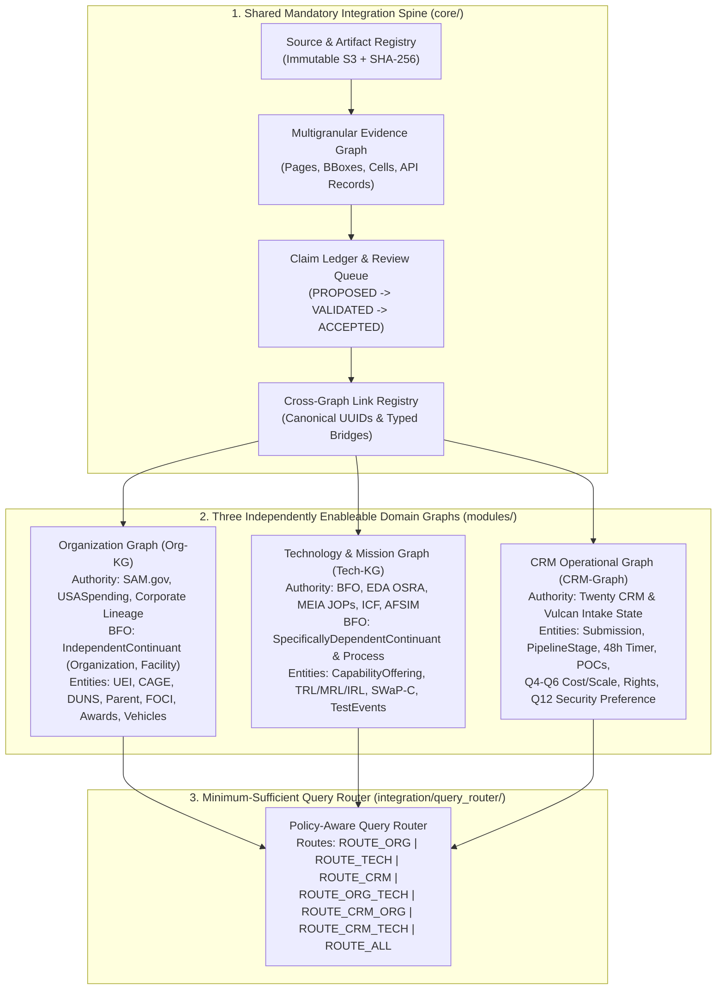

# MEIA Federated 3-Graph Competency Questions Catalog (78 CQs)
## Aligned with the MetaTheorem Modular Deployment Strategy & MEIA Ontology Backend Implementation Plan

> **Architectural Baseline**:
> - [`MetaTheorem_Modular_Deployment_Options_Analysis.md`](file:///C:/Users/kenai/OneDrive/Documents/Projects/weld/MAT/MetaTheorem_Modular_Deployment_Options_Analysis.md)
> - [`MEIA_CRM_Ontology_Backend_Implementation_Plan.md`](file:///C:/Users/kenai/OneDrive/Documents/Projects/weld/IBM_projects/MEIA/background/implementation/MEIA_CRM_Ontology_Backend_Implementation_Plan.md)
> - [`MEIA_Ontology_Competency_Questions.md`](file:///C:/Users/kenai/OneDrive/Documents/Projects/weld/IBM_projects/MEIA/background/implementation/MEIA_Ontology_Competency_Questions.md)
> - [`MEIA_TEM_Vulcan_Export.xlsx`](file:///C:/Users/kenai/OneDrive/Documents/Projects/weld/IBM_projects/MEIA/background/MEIA_TEM_Vulcan_Export.xlsx) & [`CRM_Object_Field_Mapping.xlsx`](file:///C:/Users/kenai/OneDrive/Documents/Projects/weld/IBM_projects/MEIA/background/CRM_Object_Field_Mapping.xlsx)
> - [`MEIA Charter - 2026.pdf`](file:///C:/Users/kenai/Downloads/MEIA%20Charter%20-%202026.pdf), `https://www.meia.mil/`, [`Company Data`](file:///C:/Users/kenai/OneDrive/Documents/Projects/weld/IBM_projects/MEIA/background/Company%20Data/Company%20Data), and USASpending API telemetry.

---

## 1. Architectural Review & Synthesis of the Implementation Plan

### 1.1 Alignment Assessment: Why the Modular Monolith + Shared Spine Works
The architecture defined in [`MetaTheorem_Modular_Deployment_Options_Analysis.md`](file:///C:/Users/kenai/OneDrive/Documents/Projects/weld/MAT/MetaTheorem_Modular_Deployment_Options_Analysis.md) and [`MEIA_CRM_Ontology_Backend_Implementation_Plan.md`](file:///C:/Users/kenai/OneDrive/Documents/Projects/weld/IBM_projects/MEIA/background/implementation/MEIA_CRM_Ontology_Backend_Implementation_Plan.md) is **100% sound and directly applicable** to the client's requirement for three domain graphs (**Organization**, **Technology**, and **CRM**).

Specifically, three architectural decisions in the implementation plan prevent the exact failure modes encountered in the AWS A3.0 prototype:
1. **Logical Separation Without Premature Microservice Sprawl**: Running the graphs in a single modular monolith (NetworkX `MultiDiGraph` + JSONL/Parquet snapshots + PostgreSQL control plane) preserves independent schemas, lifecycles, and authority boundaries without paying distributed-systems overhead during the POC.
2. **Append-Only Claim Ledger Before KG Publication**: LLM or parser extractions never write directly to the canonical Knowledge Graph (`PROPOSED → VALIDATED → ACCEPTED → SUPERSEDED`).
3. **Multigranular Evidence Graph Grounding**: Every accepted semantic edge in the Organization or Technology graph binds to an immutable `EvidenceNode` (exact spreadsheet cell `Sheet!Row:Col`, PDF page/bounding box, or USASpending transaction ID) with SHA-256 source checksums.

### 1.2 Reconciling the Client's 3-Graph Model with the MetaTheorem Architecture

To satisfy the client's three-domain requirement (`Organization`, `Technology`, `CRM`) while preserving MetaTheorem's `Evidence Graph` and `Claim Ledger`, the backend should partition the semantic plane into **three distinct domain graph modules** resting on the **shared Evidence & Provenance Spine**:



### 1.3 Cross-Graph Link Registry Contracts (`integration/link_registry/`)
Instead of duplicating nodes across the three graphs, the **Link Registry** maintains typed cross-graph bridge edges anchored by deterministic UUIDv5 canonical IDs:

| Bridge Edge | Source Graph Node | Target Graph Node | Join Key / Shared Spine Anchor |
| :--- | :--- | :--- | :--- |
| `SUBMITTED_BY_ORG` | `CRM:Submission` | `Org:Organization` | `organization_id` (resolved via `UEI` / `CAGE` / normalized domain) |
| `PROPOSES_OFFERING` | `CRM:Submission` | `Tech:CapabilityOffering` | `offering_id` (Vulcan Scoutcard ID / canonical offering UUID) |
| `OFFERS_CAPABILITY` | `Org:Organization` | `Tech:CapabilityOffering` | `organization_id` $\leftrightarrow$ `offering_id` |
| `PROCURED_OR_TESTED_UNDER`| `Tech:DemonstrationEvent` | `Org:ContractAward` | `piid` / `award_id` (e.g., `FA864926P0253`, `692M1526P00126`, NSWC PC PO) |
| `SUPPORTED_BY_EVIDENCE` | Any Claim (`Org`/`Tech`/`CRM`) | `Evidence:EvidenceNode` | `claim_id` $\leftrightarrow$ `evidence_node_id` (`source_version_id` + locator) |

---

## 2. Benchmark Distribution & Routing Matrix (78 Competency Questions)

| Profile | Route Class | Question IDs | Count | Architectural Purpose |
| :--- | :--- | :--- | :---: | :--- |
| **Profile A: Organization Graph Standalone** | `ROUTE_ORG` | `CQ-01` – `CQ-18` | **18** | Validates corporate identity, CAGE/UEI/DUNS, parent lineage, FOCI, socioeconomic status, and USASpending procurement analytics. |
| **Profile B: Technology & Mission Graph Standalone** | `ROUTE_TECH` | `CQ-19` – `CQ-36` | **18** | Validates BFO classification, EDA OSRA taxonomy (`TBB`), MEIA JOPs/Topics (Q1–Q3, Q7–Q11), TRL/MRL/IRL trajectories, SWaP-C, and ICF mission-to-system paths. |
| **Profile C: CRM Operational Graph Standalone** | `ROUTE_CRM` | `CQ-37` – `CQ-50` | **14** | Validates Twenty CRM workflow state, 48h timers, encrypted POCs, stakeholder roles, Q4–Q6 cost/scale, IP rights, export control, and Q12 security preferences. |
| **Profile D1: 2-Way Join (`Org ⋈ Tech`)** | `ROUTE_ORG_TECH` | `CQ-51` – `CQ-57` | **7** | Validates cross-graph joins between vendor corporate/contract profiles and technical capabilities/demonstrations. |
| **Profile D2: 2-Way Join (`CRM ⋈ Org`)** | `ROUTE_CRM_ORG` | `CQ-58` – `CQ-62` | **5** | Validates CRM pipeline submissions against verified federal entity registrations, FOCI flags, and past performance. |
| **Profile D3: 2-Way Join (`CRM ⋈ Tech`)** | `ROUTE_CRM_TECH` | `CQ-63` – `CQ-67` | **5** | Validates CRM commercial terms (cost, scale, rights, pipeline stage) against technical readiness and mission fit. |
| **Profile D4: 3-Way Tri-Store Dossiers (`CRM ⋈ Org ⋈ Tech`)**| `ROUTE_ALL_TRI_STORE`| `CQ-68` – `CQ-72` | **5** | Validates full 360° executive business & capability assessment reports across all three graphs plus Evidence locators. |
| **Profile D5: Provenance, Routing & Fail-Closed Gates** | `FAIL_CLOSED_GATE` | `CQ-73` – `CQ-78` | **6** | Enforces exact evidence locators, conflict surfacing, claim-vs-demonstration non-equivalence, capability manifests, access control, and clean abstention. |
| **TOTAL** | **All Routes** | **`CQ-01` – `CQ-78`** | **78** | **Complete Federated Benchmark Suite** |

---

## 3. Profile A: Standalone Organization Graph (`Org-KG` · `ROUTE_ORG` · CQs 01–18)

*Governing question: **Who is the legal entity, how is it structured and owned, and what is its verified federal procurement record?***

| ID | Competency Question | Readiness | Required Concepts & Relations | Extraction Contract & Grounded Corpus Example |
| :--- | :--- | :--- | :--- | :--- |
| **CQ-01** | What is the legal business name, doing-business-as (DBA) aliases, corporate website, and country of incorporation for an organization? | Direct | `Organization` (`bfo:IndependentContinuant`), `Alias`, `Website`, `Country`, `INCORPORATED_IN` | Extracts canonical string name, alias array, normalized URL, and ISO country. *Ex: `Albacore`, `https://www.albacore.inc/`, `United States`; `T2S Solutions (T2S, LLC)`, `http://t2s-solutions.com/`.* |
| **CQ-02** | Which federal and commercial identifiers (UEI, CAGE code, DUNS number) are recorded for the organization, and which are missing? | Direct | `Organization`, `ExternalIdentifier` (`UEI`, `CAGE`, `DUNS`), `IDENTIFIES` | Enforces 12-char alphanumeric UEI, 5-char CAGE, 9-digit DUNS; explicit `NOT_RECORDED` when absent. *Ex: Albacore CAGE `0QSF0` (UEI/DUNS `NOT_RECORDED` in Vulcan); Voltage Vessels CAGE `9W2W3`, DUNS `054450388`; Fluor UEI `NZ9CUMF36PK1`, DUNS `858434525`.* |
| **CQ-03** | What organization type, business category, and subcategory are recorded for the vendor? | Direct, Derived | `Organization`, `OrganizationClassification`, `CLASSIFIED_AS` | Preserves source labels and maps to controlled enum. *Ex: Albacore & Voltage Vessels: Type=`Commercial`, Category=`U.S. Small Business`, Subcategory=`Startup`; T2S: Category=`U.S. Small Business Disadvantaged`.* |
| **CQ-04** | What is the complete physical headquarters address (street line, city, state, ZIP+4, country, and congressional district) of the organization? | Direct | `Organization`, `PhysicalAddress`, `CongressionalDistrict`, `LOCATED_AT` | Structured address object. *Ex: Albacore: `21 East 90th Street, New York, NY 10128, USA`; KLAS: `450 Springpark Pl Ste 1200, Herndon, VA 20170-5243 (VA-11)`; Prometheus: `59 Blackland Rd NW, Atlanta, GA 30342-4407 (GA-06)`.* |
| **CQ-05** | Does the organization have a corporate parent or ultimate parent entity, and what are the parent's legal name, UEI, and DUNS? | Direct, Joined | `Organization`, `ParentOrganization`, `HAS_PARENT`, `ULTIMATE_PARENT` | Links child-to-parent recipient nodes. *Ex: Fluor Federal Services (`NZ9CUMF36PK1`) $\rightarrow$ Parent: `FLUOR CORPORATION` (`MFA3GM9L8X58`, DUNS `006907190`); KLAS Government (`KQ28QJU21GY3`) $\rightarrow$ Parent: `KLAS TELECOM SERVICES INC.` (`NLLHG2HKNSH3`).* |
| **CQ-06** | Is the organization foreign-owned, foreign-controlled, or flagged for Foreign Ownership, Control, or Influence (FOCI)? | Direct, Governed | `Organization`, `FOCIStatus`, `ForeignOwnershipIndicator`, `HAS_FOCI_FLAG` | Extracts USASpending `foreign_owned_and_us_located_business` and brochure EMEA headquarters. *Ex: KLAS Government Inc. = `TRUE` (US office in Herndon, VA; EMEA corporate headquarters at One Kilmainham Square, Dublin 8, Ireland).* |
| **CQ-07** | What socioeconomic small-business certifications (Small Business, SDVOSB, VOSB, WOSB, EDWOSB, HUBZone, 8(a), SDB) are recorded for the organization? | Direct | `Organization`, `SocioeconomicDesignation`, `CERTIFIED_AS` | Boolean flags per designation with source authority. *Ex: Prometheus Intelligence (`PW8DT7RK5261`): `Small Business=TRUE`, `SDVOSB=TRUE`, `Veteran-Owned=TRUE`; Fluor (`NZ9CUMF36PK1`): `other_than_small_business=TRUE`.* |
| **CQ-08** | Which organization records are candidate duplicates or sister subsidiaries based on shared CAGE, UEI, parent lineage, normalized name, or web domain? | Derived, Governed | `OrganizationCandidate`, `ResolutionDecision`, `POSSIBLE_SAME_AS`, `SISTER_ENTITY_OF` | Disambiguates related entities without silent merging. *Ex: Resolves `KLAS GOVERNMENT INC` (`KQ28QJU21GY3`, active prime/sub) vs. `KLAS, INC.` (`L3T9VHGP44D1`, dormant sub-only entity with 1 Booz Allen subaward).* |
| **CQ-09** | What primary and secondary NAICS codes and descriptions are associated with the organization's federal contracting history? | Direct, Derived | `Organization`, `NAICSCode`, `OPERATES_UNDER_NAICS` | Ranked NAICS list by award count and obligation. *Ex: Fluor: `541611` (Admin/Mgmt Consulting), `236220` (Commercial Bldg Constr); KLAS: `334220` (Wireless Comm Equip Mfg), `334290`; Prometheus: `541512` (Computer Systems Design), `541715` (R&D).* |
| **CQ-10** | What Product Service Codes (PSCs) characterize the goods and services delivered by the organization? | Direct, Derived | `Organization`, `PSCCode`, `DELIVERS_PSC` | Ranked PSC list. *Ex: Fluor: `R429` (Emergency Response/Disaster Planning); KLAS: `5895` (Misc Comm Equip), `5810` (COMSEC); Prometheus: `DA10` (SaaS Business App), `AC32` (Defense Applied R&D).* |
| **CQ-11** | What is the organization's total all-time federal prime spending and its annual obligation trend by fiscal year (including FY25 and FY26)? | Derived | `Organization`, `FederalSpendSummary`, `FYObligation`, `HAS_OBLIGATION_HISTORY` | Exact currency aggregation from USASpending. *Ex: Fluor: `$908,563,277.18` all-time (`$206,556,990.49` in FY25); KLAS: `$4,625,880.11` all-time prime; Prometheus: `$1,294,105.00` all-time prime.* |
| **CQ-12** | How many prime federal contract awards (total, active, and completed) does the organization hold, and what are its average and largest contract values? | Derived | `Organization`, `PrimeContractSummary`, `ContractAward`, `HOLDS_AWARD` | Counts active (`end_date >= today`) vs. closed awards, mean, and max obligation. *Ex: Fluor: 47 prime awards (7 active, 40 completed), avg `$22.64M`, max `$505.92M` (`DEDT0007774`); Prometheus: 3 prime awards (2 active, 1 completed), avg `$431.4K`, max `$937.5K` (`$6.84M` ceiling).* |
| **CQ-13** | Which federal agencies and sub-agencies are the organization's primary customers by award count and obligated dollars? | Derived | `Organization`, `GovernmentAgency`, `SubAgency`, `CONTRACTED_BY` | Ranked agency map. *Ex: Fluor: DHS (`$547.84M`), DOE (`$505.92M`), DoD (`$10.40M`); KLAS: DoD (`$3.69M`), DoJ (`$618.5K`), State (`$513.7K`); Prometheus: DoD Army & Air Force (`$1.05M`), DoT/FAA (`$248.0K`).* |
| **CQ-14** | How many federal subawards and total subaward dollars has the organization received, and which Prime Contractors issued them? | Joined, Derived | `Organization`, `Subaward`, `PrimeContractor`, `RECEIVED_SUBAWARD_FROM` | Aggregates subaward count, dollar sum, and prime pass-through entities. *Ex: KLAS (`KQ28QJU21GY3`): 106 subawards totaling `$45,435,362.77` from primes including Atlantic Diving Supply (`$11.98M` under `SPE8EL23F12JM`), CACI, General Dynamics; Fluor: 13 subawards (`$67.56M`).* |
| **CQ-15** | What is the organization's Prime-to-Subaward ratio, and does it operate primarily as a prime integrator or a sub-tier supplier? | Derived | `Organization`, `PrimeVsSubMetric`, `INDUSTRIAL_TIER_ROLE` | Computes `prime_awards / (prime_awards + subawards)`. *Ex: Fluor = `0.783` (Prime Integrator); KLAS = `0.237` (Tier-2/3 Hardware Supplier to Defense Primes); Prometheus = `1.000` (Direct Prime Provider).* |
| **CQ-16** | What percentage of the organization's prime awards were competed (Full & Open) versus non-competed / sole-source, and under what authorities? | Derived | `Organization`, `CompetitionMetric`, `CompetitionAuthority`, `AWARDED_VIA_COMPETITION` | Computes competed vs. sole-source percentages and FAR codes. *Ex: Fluor: `100% Competed` (`0% Sole Source`); KLAS: `42.4% Competed` / `57.6% Sole Source` (`NOT COMPETED UNDER SAP`); Prometheus: `33.3% Competed` / `66.7% Sole Source` (`FAR 13 SAP`, `FAA AMS 3.2.2.4`).* |
| **CQ-17** | What contract pricing structures (Firm Fixed Price, Time & Materials, Cost-Plus) dominate the organization's federal awards? | Derived | `Organization`, `ContractPricingModel`, `USES_PRICING` | Mode and distribution of FPDS `pricing_desc`. *Ex: Fluor: `TIME AND MATERIALS` (38/47 awards, 81%), `FFP` (8), `CPAF` (1); KLAS: `100% FIRM FIXED PRICE` (33/33); Prometheus: `100% FIRM FIXED PRICE` (3/3).* |
| **CQ-18** | Which Indefinite Delivery Vehicles (IDVs/IDIQs), GWACs, or master ordering agreements does the organization hold or receive orders under? | Direct, Joined | `Organization`, `ContractVehicle`, `ParentIDV`, `ORDERED_UNDER_VEHICLE` | Extracts `parent_idv_piid`, vehicle type, and order count. *Ex: Fluor: DHS FEMA PA-TAC V (`70FB8024D00000003`, 21 orders), PA-TAC IV (`70FB8018D00000001`, 18 orders), DoD USACE (`W9128F15D0038`, 5 orders); KLAS: Army TARDEC VTR IDIQ (`W56HZV13D0075`).* |

---

## 4. Profile B: Standalone Technology & Mission Graph (`Tech-KG` · `ROUTE_TECH` · CQs 19–36)

*Governing question: **What is the technical capability, how does it work, how is it classified under defense ontologies, and what engineering evidence proves its maturity?***

| ID | Competency Question | Readiness | Required Concepts & Relations | Extraction Contract & Grounded Corpus Example |
| :--- | :--- | :--- | :--- | :--- |
| **CQ-19** | What is the canonical name, model/version series, and offering type (`Prototype`, `Product`, `COTS`) of each technology capability? | Direct | `CapabilityOffering` (`bfo:SpecificallyDependentContinuant`), `OfferingType`, `HAS_TYPE` | Preserves offering title and normalized product name. *Ex: `Ghostfin` (`Type: Prototype`); `Eclipse X9 Distributed Composite Manufacturing for Austere Logistics` (`Type: Product`); `Counter Sensing` (`Type: Prototype`); `Klas Voyager 2` / `VoyagerVM 4.0` (`Type: Product`); `Prometheus Torch` (`Type: Product`).* |
| **CQ-20** | At what system hierarchy level (Vulcan Q11: `"My capability is:"`) does the technology operate? | Direct | `CapabilityOffering`, `SystemHierarchyScope`, `OPERATES_AT_LEVEL` | Controlled enum from Q11. *Ex: Ghostfin: `a fully integrated solution / system`; Voltage Vessels & T2S: `NOT_RECORDED` in Q11 cell (inferred only in review queue, never silently filled).* |
| **CQ-21** | What is the technical description and architectural composition of the capability offering? | Direct | `CapabilityOffering`, `TechnicalDescription`, `SystemComponent`, `HAS_COMPONENT` | Full uncut description plus extracted subsystem nodes. *Ex: Ghostfin: long-range hybrid-electric medium UUV; KLAS TrueTactical: Voyager chassis + VoyagerVM 4.0 compute/GPU + KlasOS Keel KVM hypervisor + Blackrock Ansible automation.* |
| **CQ-22** | What core technical differentiator distinguishes the capability's engineering design? | Direct | `CapabilityOffering`, `TechnicalDifferentiator`, `DIFFERENTIATED_BY` | Extracts specific physical/algorithmic mechanism. *Ex: Ghostfin: compact hybrid-electric power system combining a JP-8 combustion engine and battery; Eclipse X9: integrated expeditionary LFAM printer + proprietary composite material; T2S: government-owned multi-vendor effector orchestrator.* |
| **CQ-23** | What unique competitive advantage over existing commercial or defense baselines is claimed for the solution (Vulcan Q8)? | Direct | `CapabilityOffering`, `CompetitiveAdvantage`, `CONTRASTS_WITH_BASELINE` | Verbatim Q8 claim bound to source cell. *Ex: Ghostfin: `"Hybrid-electric powertrain; no comparable industry alternative exists today"`; Voltage Vessels: `"Rapid local production and repair of rugged composite mission hardware"`.* |
| **CQ-24** | How is the capability modeled under Basic Formal Ontology (BFO) upper-level categories? | Governed, Structural | `bfo:IndependentContinuant`, `bfo:SpecificallyDependentContinuant`, `bfo:Quality`, `bfo:Process`, `REALIZES` | Enforces strict BFO typing: physical hardware (`UUV Airframe`, `Voyager 2 Chassis`) as `MaterialEntity` (`IndependentContinuant`); capability (`1000 nmi Undersea Transit`) as `Disposition`/`Capability` (`SpecificallyDependentContinuant`); TRL/SWaP as `Quality`; live test/simulation as `Process` (`Occurrent`). |
| **CQ-25** | Which European Defence Agency (EDA) OSRA Defence Technology Taxonomy Building Blocks (`TBB`) classify the capability? | Governed | `CapabilityOffering`, `osra:TechnologyBuildingBlock`, `CLASSIFIED_UNDER_OSRA` | Governed taxonomy mapping with reviewer metadata. *Ex: Ghostfin $\rightarrow$ `TBB-29` (Underwater Unmanned Vehicles) & `TBB-41` (Hybrid Propulsion); Eclipse X9 $\rightarrow$ `TBB-54` (Additive Manufacturing & Advanced Materials); KLAS Voyager $\rightarrow$ `TBB-72` (Tactical Communications) & `TBB-76` (COMSEC); Prometheus Torch $\rightarrow$ `TBB-83` (AI/Cognitive) & `TBB-85` (Human Language/Speech Tech).* |
| **CQ-26** | Which active MEIA Topic Area(s) (`meia.mil` & Vulcan Q2) does the capability align to? | Direct | `CapabilityOffering`, `MEIATopicArea`, `HAS_SOURCE_ALIGNMENT` | Matches source strings to official MEIA topics. *Ex: Ghostfin: `Counter C5ISR-T`, `Multi-Domain Collaborative Autonomy`; Eclipse X9: `Contested Logistics`; T2S Counter Sensing: `Counter C5ISR-T`.* |
| **CQ-27** | How do source taxonomy labels map across MEIA Topic Areas, EFDI Focus Areas, Vulcan labels, TMTR categories, ICF Mission Areas, and EDA OSRA schemes, and which terms remain `UNMAPPED`? | Governed | `ConceptScheme`, `Concept`, `ConceptMapping` (`EXACT_MATCH`, `CLOSE_MATCH`, `BROADER_THAN`, `UNMAPPED`) | Cross-scheme mapping table with explicit `UNMAPPED` or `NEEDS_REVIEW` queue for unresolved terms (prevents silent union collisions between MEIA and EFDI). |
| **CQ-28** | What warfighter operational problem and Joint Operational Problem (JOP) gap does the capability address (Vulcan Q1 & MEIA Charter)? | Direct, Joined | `CapabilityOffering`, `OperationalProblem`, `JointOperationalProblem`, `ADDRESSES_PROBLEM` | Links Q1 narrative to JOP nodes. *Ex: Ghostfin: closes undersea standoff distance and payload gaps for UUVGRU, SOF dive teams, and USMC stand-in forces; T2S: counters adversary ability to locate and target high-value assets.* |
| **CQ-29** | What specific, quantifiable operational capability contribution does the solution deliver (Vulcan Q3)? | Direct | `CapabilityOffering`, `CapabilityContribution`, `QuantitativeParameter`, `DELIVERS_CONTRIBUTION` | Extracts structured numerical metrics + units alongside text. *Ex: Ghostfin: Range=`1000 nmi`, Crew portability=`4-man carryable`, Payload=`250 lbs`; T2S: automated coordination of JWICS planning tools to multi-domain effectors.* |
| **CQ-30** | What physical Size, Weight, Power, and Cooling (SWaP-C) and environmental ruggedization standards are specified in technical brochures? | Direct | `CapabilityOffering`, `SWaPSpecification`, `EngineeringStandard`, `CONFORMS_TO_STANDARD` | Extracts brochure table specs. *Ex: KLAS Voyager 2: 2-module rugged low-power chassis (`VoyagerESR`, `VoyagerVM`), x86 compute, pass-through USB/serial; Ghostfin: 4-man portable form factor, JP-8 fuel compatibility.* |
| **CQ-31** | What are the recorded Technology Readiness Level (TRL), Manufacturing Readiness Level (MRL), and Integration Readiness Level (IRL) values for the capability, and which scales are missing? | Direct | `CapabilityOffering`, `ReadinessObservation` (`TRL`, `MRL`, `IRL`), `HAS_READINESS` | Validates integer bounds (`TRL: 1..9`, `MRL: 1..10`, `IRL: 1..9`) and flags missing scales as `NOT_RECORDED`. *Ex: Ghostfin: `TRL=6, MRL=8, IRL=6`; Eclipse X9: `TRL=8, MRL=9, IRL=7`; T2S Counter Sensing: `TRL=5, MRL=NOT_RECORDED, IRL=7`.* |
| **CQ-32** | What is the chronological readiness trajectory recorded for the capability (`TRL 1 Date`, `Current TRL Date`, `Projected TRL 9 Date`), and which Capabilities meet a specified minimum threshold (e.g., `TRL >= 6`)? | Direct, Derived | `CapabilityOffering`, `ReadinessObservation`, `Milestone`, `OBSERVED_ON_DATE`, `PROJECTED_FOR_DATE` | Distinguishes historical observations from future projections; excludes `NOT_RECORDED` from threshold filters. *Ex: Ghostfin: `TRL 1 = 2024-11-01`, `Current TRL 6 = 2025-12-01`, `Projected TRL 9 = 2026-12-01`.* |
| **CQ-33** | What is the vendor's qualitative self-assessment of technical maturity (Vulcan Q9)? | Direct | `CapabilityOffering`, `MaturitySelfAssessment`, `CLAIMS_MATURITY_TIER` | Preserves ordinal and text. *Ex: Ghostfin, Eclipse X9, and T2S all record: `(3) I have tested my prototype / solution and it works`.* |
| **CQ-34** | What performance measures and evaluation metrics are defined for assessing the capability (Vulcan Q7 & TMTR)? | Direct, Structural | `CapabilityOffering`, `Measure`, `MetricDefinition`, `MEASURED_BY` | Extracts measured properties without inventing thresholds. *Ex: Ghostfin: range, mission endurance, payload carried, data collected per mission; Eclipse X9: tensile strength, durability, print repeatability, field-use fit.* |
| **CQ-35** | What software/hardware integration architecture, open standards, and cryptographic provisioning mechanisms are supported (Vulcan Q10 & Brochures)? | Direct | `CapabilityOffering`, `Interface`, `SoftwareStack`, `CryptographicStandard`, `SUPPORTS_INTERFACE` | Extracts interoperability hooks. *Ex: KLAS: `KlasOS Keel` Linux KVM hypervisor, `Blackrock` Ansible + `Nautobot` SoT, error-free NSA `CSfC` provisioning in 7 minutes, `JWCC` VM portability; T2S: `JWICS` planning tool integration.* |
| **CQ-36** | How does the capability trace through the ICF & MEIA Mission Engineering spine (`MissionArea → Scenario → DesiredEffect → Task → SystemFunction → System/Offering`)? | Structural, Governed | `MissionArea`, `Scenario`, `DesiredEffect`, `Task`, `SystemFunction`, `RequiredCapability`, `CapabilityOffering`, `PROPOSED_FOR`, `ENABLED_BY` | Separates authoritative `RequiredCapability` (mission need) from vendor `CapabilityOffering` (`PROPOSED_FOR`), tracing how a system function enables a joint task and kill-chain effect. |

---

## 5. Profile C: Standalone CRM Operational Graph (`CRM-Graph` · `ROUTE_CRM` · CQs 37–50)

*Governing question: **What is the operational engagement state, who are the stakeholders, what are the commercial/cost/rights terms, and what workflow actions are pending in Twenty CRM?***

| ID | Competency Question | Readiness | Required Concepts & Relations | Extraction Contract & Grounded Corpus Example |
| :--- | :--- | :--- | :--- | :--- |
| **CQ-37** | What submission identifiers, Scoutcard URLs, first-submitted timestamps, and last-updated timestamps are recorded in the intake system? | Direct | `Submission`, `SourceRecord`, `ExternalURL`, `SUBMITTED_AT`, `UPDATED_AT` | Preserves immutable source keys and timezone-aware timestamps. *Ex: Ghostfin: Vulcan ID `26705`, Submitted `2026-05-02 13:37 EST`, Updated `2026-05-12 09:25 EST`; Eclipse X9: ID `25615`; Counter Sensing: ID `27268`.* |
| **CQ-38** | What are the current Twenty CRM pipeline stage, assessment status, go/no-go decision, 48-hour callback timer state, and escalation level for a submission? | Direct, Joined | `Submission`, `WorkflowState`, `Assessment`, `Decision`, `CallbackTimer`, `HAS_WORKFLOW_STATE` | Queries Twenty operational authority (`portal-service` and `timer-service`), keeping workflow status distinct from KG claim acceptance. |
| **CQ-39** | Who are the Primary and Secondary vendor Points of Contact (`POC 1`, `POC 2`), including full name, email, and phone number? | Direct, Joined | `Person`, `ContactPoint`, `Role` (`PRIMARY_POC`, `SECONDARY_POC`), `CONTACT_FOR` | Enforces PII encryption/redaction labels (`Encrypted=Y`). *Ex: Ghostfin POC 1: `Dante Vaisbort` (`dante@albacore-redacted.local`, `1310-REDACTED`), POC 2: `Andrew Wong` (`andrew@albacore-redacted.local`, `1908-REDACTED`); Eclipse X9 POC 1: `Sam Young` (`sam@voltage-redacted.local`); T2S POC 1: `Michael Roesch` (`mroesch@t2s-redacted.local`).* |
| **CQ-40** | Which Government Sponsors, Technical Leads, Operational Users, Maintainers, and Collaborators (`Sponsor 1`, `Technical 1`, `User 1`, `Maintainer 1`, `Collaborator 1`) are recorded on a submission? | Direct, Joined | `Person`, `StakeholderRole`, `Submission`, `HAS_STAKEHOLDER` | Preserves role-qualified links rather than collapsing into generic contacts; returns `NOT_RECORDED` for blank role columns. *Ex: Ghostfin `Technical 1`: `Cameron Matthews` (`cameron.matthews@navy-redacted.local`, `1850-REDACTED`); `Sponsor 1`, `User 1`, `Maintainer 1`, `Collaborator 1` = `NOT_RECORDED`.* |
| **CQ-41** | What is the vendor's One-on-One Meeting Security Preference (Vulcan Q12) for engaging with MEIA evaluators? | Direct | `Submission`, `MeetingSecurityPreference`, `REQUIRES_MEETING_SECURITY` | Extracts exact security preference string. *Ex: Ghostfin: `SECRET // REL FVEY`; Eclipse X9: `I do not have an active security clearance.`; T2S Counter Sensing: `TOP SECRET // SCI (4-Pack)`.* |
| **CQ-42** | What funding tier is requested by the vendor to scale production (Vulcan Q5: `Funding to Scale`)? | Direct | `Submission`, `FundingNeed`, `REQUESTS_SCALING_FUNDS` | Preserves exact Q5 range without fabricating point estimates. *Ex: Ghostfin: `$5M-10M`; Eclipse X9: `<$5M`; T2S Counter Sensing: `$5M-10M`.* |
| **CQ-43** | What current unit cost and projected scaled unit cost are recorded for the offering (Vulcan Q6: `Unit Cost`)? | Direct | `Submission`, `CostObservation`, `HAS_STATED_UNIT_COST` | Preserves multi-rate cost structure and units. *Ex: Ghostfin: `$500K/unit now at 1 unit/month; $250K/unit projected at 5 units/month`; Eclipse X9: `$8 to $15 per kg pellet. $100.00 a kg Filament Roll prices drop when you scale`; T2S: `TBD, Gov purpose rights SW; costs for upgrades, expansion, HW, effectors`.* |
| **CQ-44** | What production, scalability, or supply-chain constraints are disclosed by the vendor (Vulcan Q4)? | Direct | `Submission`, `ConstraintAssertion`, `DISCLOSES_CONSTRAINT` | Verbatim Q4 text bound to cell locator. *Ex: Ghostfin: requires clear demand signal to raise new IRAD funds for rapid scale; mitigates supply risk via COTS parts; Eclipse X9: scales via U.S. compounding partners and distributed LFAM deployment.* |
| **CQ-45** | What Intellectual Property, data rights, or cooperative agreement terms (`Product Rights`) are asserted on the submission? | Direct | `Submission`, `RightsAssertion`, `ASSERTS_PRODUCT_RIGHTS` | Extracts rights classification. *Ex: Ghostfin: `Government Purpose Rights`; Eclipse X9: `CRADA`; T2S Counter Sensing: `Government Purpose Rights`.* |
| **CQ-46** | Is the submitted capability marked as Export Controlled (ITAR/EAR) in the intake record? | Direct | `Submission`, `ExportControlAssertion`, `HAS_EXPORT_CONTROL_FLAG` | Boolean/enum (`Yes`, `No`, `NOT_RECORDED`). *Ex: Ghostfin: `Yes`; Eclipse X9: `No`; T2S Counter Sensing: `Yes`.* |
| **CQ-47** | Through which intake program (`MEIA` vs. `EFDI`), source system (`Vulcan`, `Twenty Portal`, `TMTR`), and outreach event did the submission enter the portfolio? | Direct, Joined | `Submission`, `Program`, `SourceSystem`, `Event`, `ENTERED_VIA_CHANNEL` | Tracks provenance channel; returns `EVENT_NOT_RECORDED` where legacy schema omitted event links (addressing CRM Backlog gap S4). |
| **CQ-48** | What internal CRM engagement metadata (Assigned Account Manager, Lead Source, Lead Status, Last Contact Date, Next Follow-up Date, Profile Verified status) is recorded? | Direct | `MeiaCompany`, `EngagementRecord`, `ASSIGNED_TO_USER`, `VERIFIED_BY` | Maps directly to the `Company` and `Opportunity` tabs of [`CRM_Object_Field_Mapping.xlsx`](file:///C:/Users/kenai/OneDrive/Documents/Projects/weld/IBM_projects/MEIA/background/CRM_Object_Field_Mapping.xlsx). |
| **CQ-49** | For an AAT TMTR intake record, what transition partner, schedule, cost, and four-dimensional risk ratings (`Cost Risk`, `Schedule Risk`, `Performance Risk`, `Budget Risk`) are recorded? | Structural, Direct | `TMTRProject`, `TransitionPartner`, `Schedule`, `RiskAssessment`, `HAS_RISK_DIMENSION` | Keeps the 4 risk dimensions distinct per [`MEIA_Ontology_Competency_Questions.md`](file:///C:/Users/kenai/OneDrive/Documents/Projects/weld/IBM_projects/MEIA/background/implementation/MEIA_Ontology_Competency_Questions.md#L118) (CQ-26). |
| **CQ-50** | Which items in the Human Review Queue (candidate entity merges, unmapped taxonomy terms, low-confidence extracted claims) are awaiting Data Steward or SME disposition? | Direct, Governed | `ReviewTask`, `Claim`, `ConceptMapping`, `ResolutionDecision`, `AWAITS_REVIEW_BY` | Queries the PostgreSQL control-plane `review_queue` table defined in [`MEIA_CRM_Ontology_Backend_Implementation_Plan.md`](file:///C:/Users/kenai/OneDrive/Documents/Projects/weld/IBM_projects/MEIA/background/implementation/MEIA_CRM_Ontology_Backend_Implementation_Plan.md#L139). |

---

## 6. Profile D: Cross-Graph Composition, Routing & Fail-Closed Gates (CQs 51–78)

### Sub-Profile D1: 2-Way Federated Joins — Organization $\bowtie$ Technology (`ROUTE_ORG_TECH` · CQs 51–57)

| ID | Competency Question | Readiness | Required Cross-Graph Path | Passing Federated Answer & Grounded Example |
| :--- | :--- | :--- | :--- | :--- |
| **CQ-51** | Which U.S. Small Business startups (`Org-KG`) offer technologies aligned to `Counter C5ISR-T` (`Tech-KG`) with a current `TRL >= 6`? | Joined, Derived | `Org:Organization [Startup]` $\xrightarrow{\text{OFFERS}}$ `Tech:CapabilityOffering [TRL>=6]` $\xrightarrow{\text{ALIGNS\_TO}}$ `Tech:MEIATopicArea [Counter C5ISR-T]` | Returns **Albacore / Ghostfin** (`Startup`, `Counter C5ISR-T`, `TRL=6`). Excludes **T2S Solutions / Counter Sensing** (`TRL=5 < 6` and `Subcategory=NOT_RECORDED`) and **Voltage Vessels** (`Contested Logistics`). |
| **CQ-52** | How do an organization's historical federal NAICS and PSC codes (`Org-KG`) align with the EDA OSRA Technology Building Blocks (`Tech-KG`) of its technical capabilities? | Joined, Governed | `Org:Organization` $\xrightarrow{\text{OPERATES\_UNDER}}$ `Org:NAICS/PSC` $\bowtie$ `Tech:CapabilityOffering` $\xrightarrow{\text{CLASSIFIED\_UNDER}}$ `Tech:osra:TBB` | Crosswalks procurement codes to defense tech blocks: *KLAS (`NAICS 334220` / `PSC 5895, 5810`) $\leftrightarrow$ `EDA TBB-72` (Tactical Comms) & `TBB-76` (COMSEC); Prometheus (`NAICS 541512, 541715` / `PSC DA10, AC32`) $\leftrightarrow$ `EDA TBB-83/85` (Edge AI / Speech).* |
| **CQ-53** | Which capabilities in the Technology Graph (`Tech-KG`) are backed by verified federal contract awards or government T&E purchases (`Org-KG`) versus brochure-only assertions? | Joined, Governed | `Tech:CapabilityOffering` $\xrightarrow{\text{DEMONSTRATED\_IN}}$ `Tech:DemonstrationEvent` $\xrightarrow{\text{PROCURED\_UNDER}}$ `Org:ContractAward` | Distinguishes verified procurement/T&E from brochure claims: *Prometheus Torch backed by AFWERX `FA864926P0253`, Army `W91CRB26PA025`, FAA `692M1526P00126`; KLAS Voyager backed by Army NIE IDIQ `W56HZV13D0075` + 106 subawards; Ghostfin backed by NSWC PC T&E purchase (`Q10`).* |
| **CQ-54** | Which organizations offering C5ISR, tactical networking, or edge compute capabilities (`Tech-KG`) carry Foreign Ownership, Control, or Influence (FOCI) indicators (`Org-KG`)? | Joined | `Org:Organization [FOCI=True]` $\xrightarrow{\text{OFFERS}}$ `Tech:CapabilityOffering [C5ISR / Tactical Comms]` | Flags **KLAS Government Inc.** (`UEI KQ28QJU21GY3`): offers `Voyager 2` / `VoyagerVM 4.0` / `KlasOS Keel` C2 platforms while flagged `foreign_owned_and_us_located_business` under Irish parent `Klas Telecom Services Inc.` (`NLLHG2HKNSH3`). |
| **CQ-55** | Which technologies originated in an SBIR/STTR R&D phase (`Org-KG`) and subsequently transitioned into sole-source operational contracts for tactical edge deployment (`Tech-KG`)? | Joined, Derived | `Org:ContractAward [SBIR/PSC AC32]` $\rightarrow$ `Tech:CapabilityOffering` $\rightarrow$ `Org:ContractAward [Sole Source SAP / PSC DA10]` | Traces **Prometheus Torch**: Air Force Applied R&D Purchase Order `FA864926P0253` (`$108.6K`, `"AI Enhanced Interviewing at the Tactical Edge"`) $\rightarrow$ Army Sole-Source PO `W91CRB26PA025` (`$937.5K` / `$6.84M` max) $\rightarrow$ FAA Single-Source `692M1526P00126` (`$248K` / `$691.2K` max). |
| **CQ-56** | Which vendors with high subaward-to-prime ratios (`PrimeVsSubRatio < 0.30` in `Org-KG`) supply modular hardware components integrated into larger DoD programs (`Tech-KG`)? | Joined, Derived | `Org:Organization [PrimeVsSub < 0.30]` $\xrightarrow{\text{OFFERS}}$ `Tech:CapabilityOffering` $\xrightarrow{\text{INTEGRATED\_INTO}}$ `Tech:DefenseProgram` | Identifies **KLAS Government Inc.** (`PrimeVsSubRatio = 0.237`, `$45.44M` across 106 subawards) supplying `Voyager` modules into Army `PEO C3T` and `T2C2` (Troop to Company Communications) via primes like ADS and CACI. |
| **CQ-57** | Where do organization-level historical capabilities (`Org-KG` PSC/NAICS) and submitted technology topic alignments (`Tech-KG`) diverge or indicate expansion into a new domain? | Joined, Derived | `Org:Organization [Historical PSC]` $\bowtie$ `Tech:CapabilityOffering [Topic Alignment]` | Surfaces capability pivots or multi-division scope (e.g., Fluor's nuclear security brochure [`Fluor_Nuclear_Security.pdf`](file:///C:/Users/kenai/OneDrive/Documents/Projects/weld/IBM_projects/MEIA/background/Company%20Data/Company%20Data/Fluor_Nuclear_Security.pdf) & DOE Paducah deactivation `DEDT0007774` vs. its DHS FEMA disaster-response task orders `R429`). |

---

### Sub-Profile D2: 2-Way Federated Joins — CRM $\bowtie$ Organization (`ROUTE_CRM_ORG` · CQs 58–62)

| ID | Competency Question | Readiness | Required Cross-Graph Path | Passing Federated Answer & Grounded Example |
| :--- | :--- | :--- | :--- | :--- |
| **CQ-58** | For all submissions in the CRM (`CRM-Graph`), which submitting vendors have complete federal registration identifiers (`UEI`, `CAGE`, `DUNS` in `Org-KG`) and which have registration gaps? | Joined | `CRM:Submission` $\xrightarrow{\text{SUBMITTED\_BY}}$ `Org:Organization` $\xrightarrow{\text{IDENTIFIES}}$ `Org:ExternalIdentifier` | Reports exact completeness: *Voltage Vessels has `CAGE=9W2W3` & `DUNS=054450388` (`UEI=NOT_RECORDED`); Albacore has `CAGE=0QSF0` (`UEI/DUNS=NOT_RECORDED`); T2S Solutions has `CAGE=NOT_RECORDED`, `DUNS=NOT_RECORDED`, `UEI=NOT_RECORDED` in Vulcan.* |
| **CQ-59** | How does a vendor's requested scaling funding in CRM (`Q5 Funding to Scale` in `CRM-Graph`) compare against its historical federal prime award volume (`Org-KG`)? | Joined, Derived | `CRM:Submission [Q5 FundingNeed]` $\bowtie$ `Org:Organization [TotalFederalSpend]` | Compares capital ask against past federal execution scale (e.g., Albacore and T2S requesting `$5M–$10M` vs. Voltage Vessels requesting `<$5M`). |
| **CQ-60** | Which CRM submissions and portal contacts (`CRM-Graph`) link to the same resolved organization (`Org-KG`), and what matching signals justify the link? | Joined, Governed | `CRM:Submission` / `CRM:ContactPoint` $\xrightarrow{\text{RESOLVES\_TO}}$ `Org:Organization` | Links `dante@albacore-redacted.local` and `andrew@albacore-redacted.local` to canonical entity `Albacore` (`CAGE 0QSF0`, domain `albacore.inc`) with explicit provenance. |
| **CQ-61** | Which submissions requesting classified one-on-one meetings (`Q12` in `CRM-Graph`) involve organizations with socioeconomic preferences or FOCI governance requirements (`Org-KG`)? | Joined | `CRM:Submission [Q12 SecurityPreference]` $\bowtie$ `Org:Organization [Socioeconomic / FOCI]` | Joins `T2S Solutions` (`Q12 = TOP SECRET // SCI (4-Pack)`) with `Org Category = U.S. Small Business Disadvantaged` (`Citizenship = United States`), and `Albacore` (`Q12 = SECRET // REL FVEY`) with `U.S. Small Business / Startup`. |
| **CQ-62** | Which government technical POCs or sponsors named on a CRM submission (`CRM-Graph`) belong to agencies that have previously contracted with or purchased from the vendor (`Org-KG`)? | Joined | `CRM:Submission` $\xrightarrow{\text{HAS\_STAKEHOLDER}}$ `CRM:Person [.mil/.gov]` $\bowtie$ `Org:ContractAward / Purchase` | Links Ghostfin's `Technical 1` POC (`Cameron Matthews`, `cameron.matthews@navy-redacted.local`) to the US Navy `NSWC PC` (Naval Surface Warfare Center Panama City) vehicle purchase recorded in Q10. |

---

### Sub-Profile D3: 2-Way Federated Joins — CRM $\bowtie$ Technology (`ROUTE_CRM_TECH` · CQs 63–67)

| ID | Competency Question | Readiness | Required Cross-Graph Path | Passing Federated Answer & Grounded Example |
| :--- | :--- | :--- | :--- | :--- |
| **CQ-63** | Which capabilities in the CRM portfolio combine high technical/manufacturing readiness (`TRL >= 6` and `MRL >= 8` in `Tech-KG`) with government-favorable IP rights (`Government Purpose Rights` or `CRADA` in `CRM-Graph`)? | Joined, Derived | `Tech:CapabilityOffering [TRL>=6, MRL>=8]` $\bowtie$ `CRM:Submission [ProductRights IN (GPR, CRADA)]` | Returns **Ghostfin** (`TRL 6, MRL 8`, `Government Purpose Rights`) and **Eclipse X9** (`TRL 8, MRL 9`, `CRADA`). Excludes **Counter Sensing** (`TRL 5`, `MRL=NOT_RECORDED`). |
| **CQ-64** | How do the unit cost and production rate projections (`Q6 Unit Cost` and `Q4 Constraints` in `CRM-Graph`) relate to the capability's Manufacturing Readiness Level (`MRL`) and COTS/material architecture (`Tech-KG`)? | Joined | `CRM:Submission [Q4, Q6]` $\bowtie$ `Tech:CapabilityOffering [MRL, Architecture]` | Connects Ghostfin's `MRL 8` and COTS component strategy to its 50% unit-cost reduction curve (`$500K @ 1/mo → $250K @ 5/mo` with `$5M–$10M` scale funding); connects Eclipse X9's `MRL 9` to domestic pellet pricing (`$8–$15/kg`). |
| **CQ-65** | Which capabilities that have completed live operational field experimentation (`SONIC SPEAR 26`, `OASIS`, or drone printability demos in `Tech-KG`) are candidates for Joint Acceleration Reserve (JAR) transition resourcing (`CRM-Graph`)? | Joined | `Tech:CapabilityOffering` $\xrightarrow{\text{DEMONSTRATED\_IN}}$ `Tech:ExperimentEvent` $\bowtie$ `CRM:Submission [FundingNeed / WorkflowState]` | Identifies **Ghostfin** (demonstrated at `SONIC SPEAR 26`, scheduled for `OASIS`, purchased by `NSWC PC`, seeking `$5M–$10M`) and **Eclipse X9** (demonstrated drone platform & printability, seeking `<$5M`). |
| **CQ-66** | Does the same canonical capability offering (`Tech-KG`) appear across multiple CRM submissions, programs (`MEIA` vs. `EFDI`), or intake versions (`CRM-Graph`)? | Joined, Governed | `CRM:Submission` $\xrightarrow{\text{PROPOSES\_OFFERING}}$ `Tech:CapabilityOffering` $\xleftarrow{\text{PROPOSES\_OFFERING}}$ `CRM:Submission` | Tracks versioned Scoutcard submissions (e.g., Vulcan URL `version=e199f508...` for Ghostfin) without duplicating the canonical `Ghostfin` capability entity. |
| **CQ-67** | For a planned MEIA experimentation campaign targeting `Contested Logistics` (`CRM-Graph` Event), which submitted capabilities (`Tech-KG`) satisfy the topic alignment and can be briefed at an `UNCLASSIFIED` level (`CRM-Graph` Q12)? | Joined, Derived | `CRM:Event [Contested Logistics]` $\bowtie$ `Tech:CapabilityOffering [Topic=Contested Logistics]` $\bowtie$ `CRM:Submission [Q12=Unclassified]` | Matches **Eclipse X9 (Voltage Vessels)**: aligned to `Contested Logistics`, `TRL 8 / MRL 9`, `Export Controlled = No`, `Q12 = I do not have an active security clearance` (Unclassified engagement ready). |

---

### Sub-Profile D4: 3-Way Tri-Store Business & Due Diligence Dossiers (`ROUTE_ALL_TRI_STORE` · CQs 68–72)

*Governing question: **Synthesize a complete, provenance-verified MEIA Executive Due Diligence Dossier combining Organization, Technology, and CRM graphs with exact Evidence Graph locators.***

| ID | Competency Question | Readiness | Tri-Store Graph Composition (`Org ⋈ Tech ⋈ CRM + Evidence`) | Required Dossier Output Structure |
| :--- | :--- | :--- | :--- | :--- |
| **CQ-68** | **Generate a complete MEIA Executive Business & Capability Dossier for Ghostfin: Long-Range, Hybrid Electric Medium UUV (Albacore).** | Joined, Derived | `Org:Albacore` $\bowtie$ `Tech:Ghostfin` $\bowtie$ `CRM:Vulcan#26705` $\bowtie$ `Evidence:Row2` | Must return all populated Vulcan fields with cell locators: **Org**: Albacore, Commercial / U.S. Small Business / Startup, 21 E 90th St NY 10128, CAGE `0QSF0`, web `albacore.inc` (`UEI/DUNS: NOT_RECORDED`). **POCs**: Dante Vaisbort (`dante@albacore-redacted.local`), Andrew Wong (`andrew@albacore-redacted.local`), Gov Tech POC Cameron Matthews (`cameron.matthews@navy-redacted.local`). **Tech**: Hybrid-electric JP-8 + battery UUV (built in Philadelphia), `Prototype`, Fully integrated system (Q11), `TRL 6` (2025-12-01), `MRL 8`, `IRL 6` (TRL 1: 2024-11-01, Proj TRL 9: 2026-12-01), Topic: `Counter C5ISR-T` & `Multi-Domain Collaborative Autonomy` (Q2), Contribution: `1000 nmi range, 4-man carryable, 250 lbs payload` (Q3), Metrics: range, endurance, payload, data collected (Q7), Demonstration: NSWC PC purchase, `SONIC SPEAR 26`, `OASIS` (Q10). **CRM/Commercial**: Scale funding `$5M-10M` (Q5), Unit cost `$500K @ 1/mo → $250K @ 5/mo` (Q6), COTS supply mitigation (Q4), `Government Purpose Rights`, `Export Controlled: Yes`, Meeting Pref: `SECRET // REL FVEY` (Q12). |
| **CQ-69** | **Generate a complete MEIA Executive Business & Capability Dossier for Eclipse X9 Distributed Composite Manufacturing for Austere Logistics (Voltage Vessels, LLC).** | Joined, Derived | `Org:VoltageVessels` $\bowtie$ `Tech:EclipseX9` $\bowtie$ `CRM:Vulcan#25615` $\bowtie$ `Evidence:Row3` | **Org**: Voltage Vessels, LLC, Commercial / U.S. Small Business / Startup, 2580a Ala Olu Pl, Haiku-Pauwela, HI 96708, CAGE `9W2W3`, DUNS `054450388`. **POC**: Sam Young (`sam@voltage-redacted.local`). **Tech**: Expeditionary LFAM composite manufacturing cell + material (`Product`), `TRL 8` (2026-02-01), `MRL 9`, `IRL 7` (TRL 1: 2022-01-01, Proj TRL 9: 2026-09-01), Topic: `Contested Logistics` (Q2), Contribution: rugged mission part production/repair at point of need (Q3), Metrics: strength, durability, print repeatability, field fit (Q7), Demo: drone platform & Eclipse X9 printability demonstration (Q10). **CRM/Commercial**: Scale funding `<$5M` (Q5), Unit cost `$8–$15/kg pellet, $100/kg filament roll` (Q6), domestic compounding partners (Q4), Rights: `CRADA`, `Export Controlled: No`, Meeting Pref: `No active security clearance` (`Q11: NOT_RECORDED`). |
| **CQ-70** | **Generate a complete MEIA Executive Business & Capability Dossier for Counter Sensing (T2S Solutions, LLC).** | Joined, Derived | `Org:T2SSolutions` $\bowtie$ `Tech:CounterSensing` $\bowtie$ `CRM:Vulcan#27268` $\bowtie$ `Evidence:Row4` | **Org**: T2S Solutions (T2S, LLC), Commercial / U.S. Small Business Disadvantaged, 4685 Millennium Dr, Belcamp, MD (`Zip/CAGE/DUNS/UEI: NOT_RECORDED` in Vulcan). **POC**: Michael Roesch (`mroesch@t2s-redacted.local`). **Tech**: Counter Surveillance Reconnaissance (CSR) Increment 1 prototype (`Prototype`), `TRL 5` (2026-04-01), `IRL 7` (`MRL: NOT_RECORDED`), Topic: `Counter C5ISR-T` (Q2), Contribution: auto-coordination of JWICS planning tools to multi-vendor effectors disrupting adversary collection (Q1/Q3/Q8), Demo/Heritage: funded via Army Futures Command All Domain Sensing CFT (Q10). **CRM/Commercial**: Scale funding `$5M-10M` (Q5), Unit cost `TBD, Gov purpose rights SW` (Q6), Rights: `Government Purpose Rights`, `Export Controlled: Yes`, Meeting Pref: `TOP SECRET // SCI (4-Pack)` (Q12). |
| **CQ-71** | **Generate a complete MEIA Executive Business & Capability Dossier for KLAS Government Inc. (Voyager / TrueTactical C5ISR Suite).** | Joined, Derived | `Org:KLASGov` $\bowtie$ `Tech:VoyagerTrueTactical` $\bowtie$ `CRM:Profile` $\bowtie$ `Evidence:Brochures+USASpending` | **Org**: KLAS Government Inc., UEI `KQ28QJU21GY3` (disambiguated from dormant `L3T9VHGP44D1`), DUNS `830620832`, Parent: Klas Telecom Services Inc. (`NLLHG2HKNSH3`), Herndon VA (VA-11), `Small Business` + `Foreign Owned & US Located` (Dublin, Ireland HQ). **Procurement**: 33 prime contracts (`$4.63M`, 100% FFP, 57.6% sole-source), 1 IDV (`W56HZV13D0075` Army TARDEC NIE VTR), **106 subawards (`$45.44M`)**, Prime/Sub ratio `0.24`, Top NAICS `334220`, PSC `5895`/`5810`. **Tech**: TrueTactical C2, `Voyager 2`, `Voyager M-Series`, `VoyagerVM 4.0` (compute/GPU/JWCC portability), `KlasOS Keel` (Linux KVM hypervisor, SD-WAN), `Blackrock` Ansible + `Nautobot` (7-min CSfC provisioning), aligned with Army `PEO C3T` & `T2C2`. **CRM Gaps**: Explicitly flags Vulcan Q4–Q9 fields as `NOT_RECORDED` (brochure + USASpending ingestion only). |
| **CQ-72** | **Generate a complete MEIA Executive Business & Capability Dossier for Prometheus Intelligence, Inc. (Prometheus Torch) and Fluor Federal Services, Inc.** | Joined, Derived | `Org:Prometheus+Fluor` $\bowtie$ `Tech:Torch+Nuclear/Emergency` $\bowtie$ `Evidence:USASpending+PDFs` | **Prometheus (`PW8DT7RK5261`)**: Atlanta GA (GA-06), `SDVOSB`, 3 prime contracts (`$1.29M` obligated, `$7.64M` ceiling, 100% FFP, 66.7% sole-source): (1) AFWERX Phase I `FA864926P0253` (`$108.6K`, Tactical Edge AI Interviewing), (2) Army PO `W91CRB26PA025` (`$937.5K` / `$6.84M` max), (3) FAA Single-Source `692M1526P00126` (`$248K` / `$691.2K` max, FAA CI role/profile dev under AMS 3.2.2.4). **Fluor (`NZ9CUMF36PK1`)**: Greenville SC, Parent `MFA3GM9L8X58`, Large Business, `$908.56M` all-time (47 prime awards, 100% competed, 81% T&M), DHS FEMA PA-TAC IV/V (`$547.8M`) & DOE Paducah (`$505.9M`). **Ingestion Alert**: Flags [`Prometheus_Energy_AI.pdf`](file:///C:/Users/kenai/OneDrive/Documents/Projects/weld/IBM_projects/MEIA/background/Company%20Data/Company%20Data/Prometheus_Energy_AI.pdf) and [`Fluor_Government_Overview.pdf`](file:///C:/Users/kenai/OneDrive/Documents/Projects/weld/IBM_projects/MEIA/background/Company%20Data/Company%20Data/Fluor_Government_Overview.pdf) as 0-text-layer raster PDFs requiring OCR. |

---

### Sub-Profile D5: Provenance, Minimum-Sufficient Routing & Fail-Closed Gates (`FAIL_CLOSED_GATE` · CQs 73–78)

| ID | Competency Question | Readiness | Governing Architectural Invariant | Required Fail-Closed / Trace Outcome |
| :--- | :--- | :--- | :--- | :--- |
| **CQ-73** | **Exact Evidence Locator & Provenance Trace**: Which exact source file, source version, SHA-256 hash, spreadsheet cell (`Sheet!Row:Col`), PDF page/bounding box, or USASpending transaction ID supports a returned claim, and which ontology and graph versions were used? | Direct, Derived | MetaTheorem Invariant #1, #2, #8 (`Minimum Answer Trace`) | Returns full provenance JSON envelope: `source_version_id`, `sha256`, `evidence_node_id`, exact locator (e.g., `MEIA_TEM_Vulcan_Export.xlsx!Vulcan Submissions!R2C56` for Ghostfin Unit Cost), `claim_id`, `graph_versions`, and `selected_modules`. |
| **CQ-74** | **Conflicting Evidence Preservation**: When two sources or versions disagree on an organization's identifier, readiness level, or deployment status, how does the system respond? | Derived, Governed | MetaTheorem Conflict Rule (`SUPPORTED_BY` vs. `CONTRADICTS`) | Returns explicit status `CONFLICTING_EVIDENCE` showing both claims, their respective `source_version_id` locators, and timestamps—never silently overwriting or averaging conflicting values. |
| **CQ-75** | **Claim vs. Empirical Demonstration Non-Equivalence Gate**: Has Vendor X's capability been verified in an AFSIM digital engineering simulation or live military exercise, or is it only a vendor assertion? | Governed | MetaTheorem Section 16.2 (`proposed ≠ validated ≠ deployed`; `brochure claim ≠ KG demonstration`) | Separates `crm:CapabilityClaim` (vendor statement) from `eval:DemonstrationEvent` (`AFSIMRun`, `SONIC SPEAR 26`, `ContractDeliverable`). If no independent test/simulation node exists, returns `UNVERIFIED_VENDOR_CLAIM`. |
| **CQ-76** | **Minimum-Sufficient Routing & Module Capability Gate**: What happens when a query requires exact PDF table/figure coordinates (`Evidence Graph`), or procurement history (`Org-KG`), in a deployment profile where that module is disabled? | Governed | MetaTheorem Section 13.3 (`INSUFFICIENT_DEPLOYED_CAPABILITY`) | Router selects minimum required modules (`selected_modules`) for supported queries, and fails closed with `status: "INSUFFICIENT_DEPLOYED_CAPABILITY"`, listing `required_modules` vs. `available_modules` when a needed graph is disabled. |
| **CQ-77** | **Access Control, PII & Security Classification Gate**: What happens when a caller without authorization requests encrypted PII contacts (`POC Email/Phone`), `Export Controlled = Yes` technical data, or `TOP SECRET // SCI (4-Pack)` / `SECRET // REL FVEY` meeting details? | Direct, Governed | Backend Implementation Plan Invariant #6 & #9 (`AccessPolicy`, `INHERITS_RESTRICTION`) | Enforces policy before graph traversal or context rendering: returns `status: "ACCESS_DENIED"` (or field-level redacted projection) with `policy_decision_id` and zero leakage of restricted nodes in the answer trace. |
| **CQ-78** | **Out-of-Scope & Unrecorded Fact Abstention Gate**: What is Ghostfin's acoustic signature decibel rating at 30 knots, or what is KLAS Government's Vulcan Q5 funding request? | Direct | MetaTheorem Fail-Closed Policy (`UNKNOWN` / `NOT_RECORDED` / `OUT_OF_SCOPE`) | Returns explicit `NOT_RECORDED` (for KLAS Vulcan Q5, since KLAS has brochures/USASpending data but no row in `MEIA_TEM_Vulcan_Export.xlsx`) and `NOT_RECORDED` / `OUT_OF_SCOPE` (for Ghostfin acoustic dB rating), with zero hallucinated numbers. |

---

## 7. Gold Evaluation Test Case Contract

Every question in `CQ-01` through `CQ-78` compiles into an automated JSON test fixture under `tests/evaluation/gold_78_cqs.jsonl` combining the schemas of [`MEIA_Ontology_Competency_Questions.md`](file:///C:/Users/kenai/OneDrive/Documents/Projects/weld/IBM_projects/MEIA/background/implementation/MEIA_Ontology_Competency_Questions.md#L163-L176) and [`MetaTheorem_Modular_Deployment_Options_Analysis.md`](file:///C:/Users/kenai/OneDrive/Documents/Projects/weld/MAT/MetaTheorem_Modular_Deployment_Options_Analysis.md#L2041-L2060):

```json
{
  "competency_question_id": "CQ-68",
  "test_case_id": "CQ-68-GHOSTFIN-DOSSIER",
  "natural_language_question": "Generate a complete MEIA business and capability assessment report for Ghostfin: Long-Range, Hybrid Electric Medium UUV.",
  "caller_context": "meia-authorized-evaluator",
  "expected_route": "ROUTE_ALL_TRI_STORE",
  "selected_modules": ["organization_graph", "technology_graph", "crm_graph", "evidence_graph"],
  "expected_status": "SUPPORTED",
  "expected_entities": [
    "org:albacore:0QSF0",
    "tech:offering:ghostfin-26705",
    "crm:submission:vulcan-26705"
  ],
  "expected_relations": [
    "SUBMITTED_BY_ORG",
    "PROPOSES_OFFERING",
    "OFFERS_CAPABILITY",
    "HAS_READINESS",
    "ALIGNS_TO_TOPIC",
    "DEMONSTRATED_IN",
    "SUPPORTED_BY_EVIDENCE"
  ],
  "expected_evidence_locators": [
    "vulcan:MEIA_TEM_Vulcan_Export.xlsx#Vulcan Submissions!R2C1:R2C62"
  ],
  "expected_missing_fields": [
    "org.uei",
    "org.duns",
    "crm.sponsor_1",
    "crm.user_1",
    "crm.maintainer_1",
    "crm.collaborator_1"
  ],
  "forbidden_assertions": [
    "Fabricated UEI or DUNS for Albacore",
    "Treating projected TRL 9 date (2026-12-01) as current achieved TRL 9"
  ],
  "budget": {
    "max_graph_hops": 3,
    "max_evidence_nodes": 25,
    "max_model_calls": 2
  },
  "ontology_version": "0.1.0"
}
```
