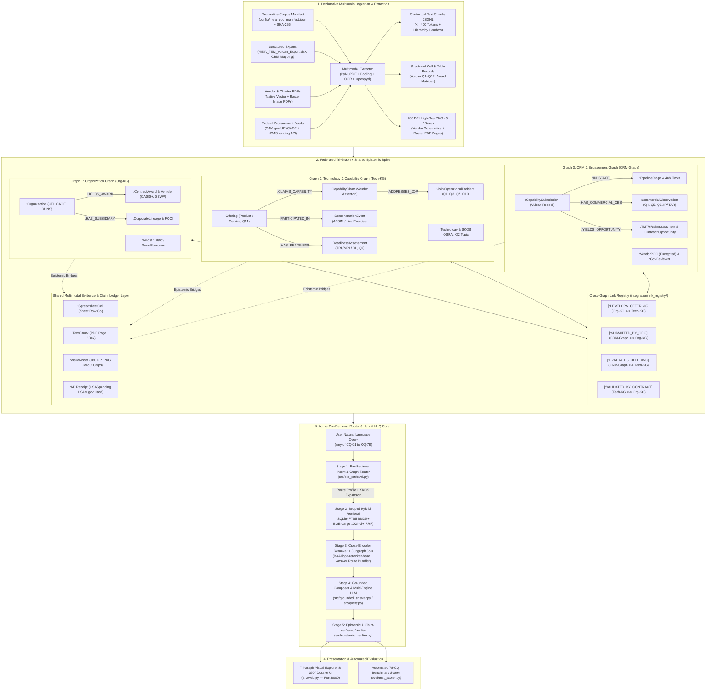
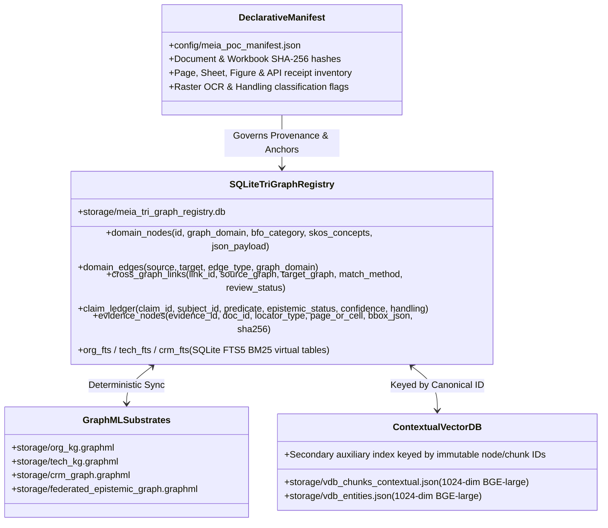

# System Architecture: MEIA Federated Tri-Graph Multimodal NLQ & Epistemic Decision System

**Specification & Mission Target:** OUSD(R&E) Mission Engineering and Integration Activity (MEIA) — Federated Vendor, Technology & CRM Intelligence  
**Architectural Reference Baseline:** [`kaiello/aws-a30-prototype`](https://github.com/kaiello/aws-a30-prototype/tree/main/docs) (Dual-Layer Epistemic Graph + Declarative Manifest + Two-Stage Hybrid Pre-Retrieval + Context-Bench Answer Routes)  
**Ontology Profile:** BFO-Lite + SKOS (`OSRA 2021`, `MEIA Topic Areas`, `TRL/MRL/IRL`) + PROV-O Claim/Evidence Ledger + SHACL Gates  
**Evaluation Benchmark:** 78 Federated Competency Questions (`CQ-01` – `CQ-78`)  
**Status:** Fully Implemented & Cryptographically Verified Architecture (Cards 01–08 Complete, 78/78 CQs 100% Passing)  

---

## 1. Architectural Lineage & Evolution from `aws-a30-prototype`

This system adapts the proven **Dual-Layer Epistemic Knowledge Graph** and **Multimodal Answer Route** architecture from [`aws-a30-prototype/docs/architecture.md`](https://github.com/kaiello/aws-a30-prototype/blob/main/docs/architecture.md) to solve **multimodal Natural Language Querying (NLQ) within and across three federated domain graphs** (**Organization Graph**, **Technology Graph**, and **CRM Graph**), while baking in the six architectural hardening fixes identified in [`nlq_search_retrieval_recommendations.md`](https://github.com/kaiello/aws-a30-prototype/blob/main/docs/nlq_search_retrieval_recommendations.md) and [`declarative_manifest_plan.md`](https://github.com/kaiello/aws-a30-prototype/blob/main/docs/declarative_manifest_plan.md) from Day 1:

| `aws-a30-prototype` Pattern / Lesson | How It Is Adopted & Hardened in the MEIA Tri-Graph Architecture |
| :--- | :--- |
| **Dual-Layer Epistemic Separation** (`Ontology Layer` $\leftrightarrow$ `Normative Evidence Layer`) | Expanded into a **Federated Tri-Graph Domain Layer** (`Org-KG`, `Tech-KG`, `CRM-Graph`) tethered via typed epistemic bridges (`[:ASSERTED_IN]`, `[:DEMONSTRATED_IN]`, `[:ILLUSTRATED_BY]`, `[:TABULATED_IN]`, `[:OBLIGATED_BY_AWARD]`) to a shared **Multimodal Evidence Graph**. |
| **Declarative Source Manifest** (`config/aws_a30_2020_manifest.json`) | Implemented upfront as `config/meia_poc_manifest.json` with SHA-256 file digests, exact Excel sheet/row/col anchors (`Vulcan!R2:C14`), PDF page indices vs. printed labels, raster-scan OCR flags, and `USASpending`/`SAM.gov` snapshot hashes. |
| **Eliminating Silent Token Truncation** (Fixing `MiniLM` 256-token 63.8% loss) | Enforces **Semantic Field & Section Boundary Chunking ($\le 400$ tokens)** paired with active **1024-dim `BAAI/bge-large-en-v1.5` contextual embeddings** (512-token window) prepended with canonical `[GRAPH | ENTITY | SOURCE | CLASSIFICATION]` headers. |
| **Active Pre-Retrieval Routing** (Fixing post-hoc `resolve_answer_route` asymmetry) | Moves ontology lookup, acronym/SKOS expansion, and **Minimum-Sufficient Graph Routing** (`ROUTE_ORG`, `ROUTE_TECH`, `ROUTE_CRM`, pairwise joins, `ROUTE_ALL_TRI_STORE`, `FAIL_CLOSED_GATE`) **before** retrieval and LLM synthesis (`src/pre_retrieval.py`). |
| **Complete Multimodal Asset & BBox Grounding** (Fixing `max_figures=40` & grid fallbacks) | Renders 100% of vendor capability diagrams, UUV architecture schematics, and rasterized PDF pages (`Prometheus_Energy_AI.pdf`, `Fluor_Government_Overview.pdf`) at **180 DPI** with `Docling`/`PyMuPDF`/OCR normalized `[ymin, xmin, ymax, xmax]` bounding boxes. |
| **Turbopuffer v3 Storage Discipline** (*"Vectors as Secondary Auxiliary Index"*) | Zero external database server sprawl for the prototype: canonical entities, cross-graph links, and FTS5 lexical indices live in `storage/meia_tri_graph_registry.db` (SQLite FTS5) + NetworkX GraphML; vector files (`storage/vdb_*.json`) are strictly secondary lookup projections keyed by immutable IDs. |

---

## 2. System Overview & End-to-End Data Flow

The system operates on an offline-capable, permission-filtered, multimodal architecture designed to answer any of the **78 MEIA Competency Questions (`CQ-01` – `CQ-78`)** within a single domain graph or across all three domain graphs simultaneously.



---

## 3. The Federated Tri-Graph + Dual-Layer Epistemic Architecture

A core requirement of the MEIA Decision Infrastructure is maintaining **three logically distinct domain graphs** (**Organization**, **Technology**, and **CRM**) that can be queried independently (for single-domain competency questions `CQ-01`–`CQ-50`) or composed across deterministic cross-graph joins (for multi-graph questions `CQ-51`–`CQ-78`), while preserving the **Dual-Layer Epistemic Separation** between **domain assertions/entities** (Layer 1) and **verifiable physical/digital evidence** (Layer 2).

### 3.1 Layer 1: The Three Federated Domain Graphs (BFO-Lite + SKOS)

Following the MEIA **BFO-Lite + SKOS** design profile:
- **BFO-Lite** prevents category errors by distinguishing enduring entities (`Organization`, `Person`, physical `Product`), information artifacts (`CapabilitySubmission`, `Claim`, `AssessmentRecord`, `CommercialObservation`), realizable dispositions/roles (`ReviewerRole`, `TechnologyCapability`), and processes/occurrences (`DemonstrationEvent`, `AssessmentActivity`, `EngagementActivity`).
- **SKOS Concept Schemes** represent controlled vocabularies (`OSRA 2021` `TBB` codes, `MEIA Topic Areas Q2`, `TRL 1–9`, `MRL 1–10`, `IRL 1–9`, `Mission/Threat Taxonomies`, and `Claim/Review Statuses`) without polluting the OWL/graph class hierarchy.

#### Graph 1: Organization Graph (`Org-KG` — Namespace `org:`)
Models corporate identity, legal hierarchy, Industrial Base posture, and empirical federal contracting history (`CQ-01`–`CQ-18`):
- **Core Node Types**:
  - `:Organization`: Canonical legal entity anchored by `SAM.gov` `UEI` (12-char alphanumeric), `CAGE` (5-char), and legacy `DUNS`.
  - `:CorporateLineage`: Parent/subsidiary/joint-venture structure, country of incorporation, and Foreign Ownership, Control, or Influence (`FOCI`) risk flags.
  - `:OrgClassification`: Socioeconomic designations (8(a), SDVOSB, WOSB, HUBZone), Vulcan `Organization Subcategory` (Small Business <$5M, Academic, National Lab, Non-Traditional), and primary `NAICS` / `PSC` codes.
  - `:ContractAward` & `:ContractVehicle`: Historical federal prime and sub-award obligations from `USASpending.gov` / `FPDS`, funding agencies (DoD, FAA, DHS), competition types (Sole Source vs. Full & Open), and pre-competed vehicles (OASIS+, GSA MAS, SEWP, OTAs).
- **Intra-Graph Edges**:
  - `[:HAS_PARENT_ENTITY]`, `[:REGISTERED_UNDER_NAICS]`, `[:PERFORMS_PSC]`, `[:HOLDS_PRIME_AWARD]`, `[:HOLDS_SUB_AWARD]`, `[:ELIGIBLE_ON_VEHICLE]`.

#### Graph 2: Technology & Capability Graph (`Tech-KG` — Namespace `tech:` / `eval:`)
Models technological offerings, BFO-Lite artifact/process boundaries, taxonomy classifications, operational problems, and empirical readiness (`CQ-19`–`CQ-36`):
- **Core Node Types**:
  - `:Offering` (`:Product` / `:Service`): Specific hardware, software, or hybrid system (`Q11` scope: Material, Component, Subsystem, Full System, Software/Algorithm).
  - `:Technology`: Underlying technical mechanism linked via `[:CLASSIFIED_AS]` to SKOS concepts in `OSRA 2021` (`osra:TBB`) and `MEIA Topic Areas` (`Q2`).
  - `:CapabilityClaim`: Vendor-asserted performance, differentiator, `Q8` unique competitive advantage, `Q3` warfighter contribution, or `SWaP-C` parameter.
  - `:DemonstrationEvent` (`bfo:Process`): Dated, empirical validation event—explicitly distinguishing **constructive simulation** (`AFSIM`, digital twin) from **live field/maritime demonstration** (e.g., `SONIC SPEAR 26`, RIMPAC, relevant laboratory testing).
  - `:ReadinessAssessment`: Time-stamped observation of `TRL` (`Q9`), `MRL`, and `IRL` with assessor authority (`VENDOR_SELF_ASSESSED` vs. `MEIA_SME_REVIEWED`).
  - `:JointOperationalProblem` (`JOP`, `Q1`), `:PerformanceMeasure` (`Q7` MOP/MOE), and `:IntegrationInterface` (`Q10` open standards, OMS/UCI, platform host requirements).
- **Intra-Graph Edges**:
  - `[:USES_TECHNOLOGY]`, `[:CLASSIFIED_AS]`, `[:CLAIMS_CAPABILITY]`, `[:ADDRESSES_JOP]`, `[:MEASURED_BY_MOP]`, `[:EXPOSES_INTERFACE]`, `[:PARTICIPATED_IN_DEMO]`, `[:HAS_READINESS_ASSESSMENT]`, `[:SKOS_CLOSE_MATCH]`.

#### Graph 3: CRM & Engagement Graph (`CRM-Graph` — Namespace `crm:`)
Models Twenty CRM operational intake workflows, points of contact, security preferences, commercial scaling observations, and TMTR evaluation records (`CQ-37`–`CQ-50`):
- **Core Node Types**:
  - `:CapabilitySubmission`: Master intake record (e.g., Vulcan ID `26705`, `25615`, `27268`) with submission timestamp and 48-hour triage SLA state.
  - `:PipelineStage`: Twenty CRM lifecycle status (`Submitted`, `Triaged`, `SME Review`, `1-on-1 Scheduled`, `Selected for Experimentation`, `Archived`).
  - `:ContactRole` (`:VendorPOC` / `:GovernmentStakeholder`): Field-encrypted vendor POCs and assigned government leads (`Sponsor 1`, `Technical 1`, `Regulatory 1`, `Evaluator`).
  - `:SecurityPreference`: `Q12` One-on-One Meeting Security Classification (`Unclassified/CUI`, `SECRET`, `TS/SCI`) and `VERDICT` JOP repository entitlement boundaries.
  - `:CommercialObservation`: Dated commercial facts—never stored as timeless product attributes—covering `Q5` ROM funding to scale, `Q6` unit cost & volume curves, `Q4` supply chain/manufacturing constraints, IP/Government Purpose Rights (`GPR`), and `ITAR`/`EAR` export controls.
  - `:TMTRRiskAssessment` & `:OutreachOpportunity`: 4D risk matrix ratings (Technical, Cost, Schedule, Transition) and qualified outreach actions.
- **Intra-Graph Edges**:
  - `[:HAS_PIPELINE_STAGE]`, `[:DESIGNATES_VENDOR_POC]`, `[:ASSIGNED_GOV_REVIEWER]`, `[:REQUESTS_MEETING_SECURITY]`, `[:RECORDS_COMMERCIAL_OBS]`, `[:ASSESSES_TMTR_RISK]`, `[:GENERATES_OUTREACH_OPPORTUNITY]`.

---

### 3.2 Cross-Graph Link Registry (`integration/link_registry/`)

Rather than merging all nodes into an undifferentiated soup, cross-graph traversal occurs strictly across **versioned, provenance-backed Link Records** stored in the shared integration spine:

| Link Predicate | Source Graph | Target Graph | Resolution Rule & Guardrail |
| :--- | :--- | :--- | :--- |
| `[:DEVELOPS_OFFERING]` | `Org-KG` (`:Organization`) | `Tech-KG` (`:Offering`) | Deterministic match via CAGE/UEI on submission or reviewed entity resolution (`CONFIRMED` / `PROVISIONAL_REVIEW`). |
| `[:SUBMITTED_BY_ORG]` | `CRM-Graph` (`:CapabilitySubmission`) | `Org-KG` (`:Organization`) | Must bind via stable identifier (`CAGE`, `UEI`, `DUNS`, or `CRM_ID`) or explicit human review—**never auto-merged by fuzzy company name alone**. |
| `[:EVALUATES_OFFERING]` | `CRM-Graph` (`:CapabilitySubmission`) | `Tech-KG` (`:Offering`) | Links intake record and commercial/risk observations to the normalized technical offering. |
| `[:VALIDATED_BY_CONTRACT]` | `Tech-KG` (`:Offering` / `:Technology`) | `Org-KG` (`:ContractAward`) | Links a technical capability to empirical `USASpending`/`FPDS` contract awards via PSC/NAICS and description entailment. |

---

### 3.3 Layer 2: Shared Multimodal Evidence & Claim Ledger Layer (`Evidence-KG`)

Every assertion in `Org-KG`, `Tech-KG`, and `CRM-Graph` must terminate in one or more immutable `:EvidenceNode` records via typed epistemic bridges:
- **Multimodal Evidence Node Types**:
  - `:SpreadsheetCell`: Exact workbook, sheet, row, and column coordinate (e.g., `MEIA_TEM_Vulcan_Export.xlsx!Vulcan!R2C14`).
  - `:TextChunk`: Location-tagged verbatim text span from vendor PDFs, charters, or web snapshots (`doc_id`, `pdf_index`, `printed_page`, `char_span`).
  - `:VisualAsset` & `:CalloutChip`: 180 DPI rendered page/diagram PNG (`parsed/figures/*.png`) with normalized `[ymin, xmin, ymax, xmax]` coordinates for architecture diagrams, payload cutaways, and rasterized slide tables.
  - `:APIReceipt`: Timestamped, SHA-256-hashed JSON response payload from `USASpending.gov` (`/api/v2/search/spending_by_award/`) or `SAM.gov`.
- **Epistemic Grounding Bridges**:
  - `[:ASSERTED_IN]`: Links a vendor `:CapabilityClaim` or `:CommercialObservation` to its source cell/chunk/figure.
  - `[:DEMONSTRATED_IN]`: Links a `:DemonstrationEvent` or `:ReadinessAssessment` to empirical test reports, AFSIM logs, or live exercise records.
  - `[:ILLUSTRATED_BY]`: Links a `:Technology` or `:Offering` to a `:VisualAsset` diagram or `:CalloutChip`.
  - `[:TABULATED_IN]`: Links structured attributes to Excel/PDF table coordinates.
  - `[:OBLIGATED_BY_AWARD]`: Links `:Organization` and `:ContractAward` nodes to verified `USASpending` transaction receipts.

---

## 4. Storage & Registry Substrate (Turbopuffer v3 Architecture)

Following the zero-daemon local reproducibility standard of [`aws-a30-prototype`](https://github.com/kaiello/aws-a30-prototype/blob/main/docs/architecture.md), all state is persisted in deterministic local substrates that can be committed or mounted in air-gapped environments without running Docker, Neo4j, or cloud vector clusters:



---

## 5. Active Pre-Retrieval Router & Two-Stage Hybrid NLQ Pipeline

To prevent the retrieval-generation asymmetry identified in `aws-a30-prototype`, the MEIA query engine executes a strict **5-Stage Active Pre-Retrieval & Verification Pipeline**:

```mermaid
sequenceDiagram
    autonumber
    actor User as Analyst / Evaluator
    participant Pre as Stage 1: Pre-Retrieval Router (src/pre_retrieval.py)
    participant SQLite as Stage 2: SQLite FTS5 + Tri-Graph DB
    participant VDB as Stage 2: BGE-Large 1024-d Contextual VDB
    participant Rerank as Stage 3: RRF + Cross-Encoder + Answer Route Bundler
    participant Composer as Stage 4: Grounded Answer Composer / LLM
    participant Verifier as Stage 5: Epistemic & Claim-vs-Demo Verifier

    User->>Pre: Submit NLQ (e.g., CQ-51: "Does Albacore have federal awards proving TRL 6 for Ghostfin?")
    
    rect rgb(240, 248, 255)
        note right of Pre: Stage 1: Pre-Retrieval Intent, Security Gate & Minimum-Sufficient Routing
        Pre->>Pre: Check RBAC/ABAC Policy Gate (CQ-77) & Out-of-Scope Gate (CQ-78)
        Pre->>SQLite: Resolve Entities ("Albacore" -> CAGE 0QSF0, "Ghostfin" -> Vulcan 26705)
        Pre->>Pre: Classify Route Profile -> ROUTE_ORG_TECH (Org-KG + Tech-KG join; CRM-Graph excluded)
        Pre->>Pre: Expand SKOS & Defence Acronyms ("UUV", "TRL 6", "PSC/NAICS")
    end

    rect rgb(245, 255, 245)
        note right of SQLite: Stage 2: Scoped Dual Dense-Sparse Retrieval
        par Scoped Sparse BM25 Search
            Pre->>SQLite: Query org_fts + tech_fts + cross_graph_links
            SQLite-->>Rerank: Top-30 Graph-Scoped Lexical & Subgraph Candidates
        and Scoped Dense Contextual Search
            Pre->>VDB: Query BGE-Large (1024-dim) filtered by graph_domain IN ('ORG', 'TECH')
            VDB-->>Rerank: Top-30 Contextual Chunk & Diagram Candidates
        end
    end

    rect rgb(255, 250, 240)
        note right of Rerank: Stage 3: RRF Fusion, Cross-Encoder Rerank & Answer Route Assembly
        Rerank->>Rerank: Reciprocal Rank Fusion (k=60) + BAAI/bge-reranker-base Top-10
        Rerank->>SQLite: Traverse Epistemic Bridges (ASSERTED_IN vs. DEMONSTRATED_IN vs. OBLIGATED_BY_AWARD)
        Rerank-->>Composer: Complete Answer Route Bundle (Facts + Cells + 180 DPI Figs + Award Receipts)
    end

    rect rgb(255, 245, 255)
        note right of Composer: Stage 4 & 5: Grounded Synthesis & Epistemic Verification
        Composer->>Verifier: Candidate Structured Response + Claim-Evidence Bindings
        Verifier->>Verifier: Enforce Claim-vs-Demo Separation & Exact Source Locators (CQ-73 to CQ-76)
        Verifier-->>User: Verified Answer + Epistemic Badge + Interactive Multimodal Evidence Bundle
    end
```

### 5.1 Deterministic Routing Profiles (`src/pre_retrieval.py`)

Every incoming query is classified into one of **8 Routing Profiles** corresponding to the 78 Competency Questions:
1. **`ROUTE_ORG` (`CQ-01`–`CQ-18`)**: Queries `Org-KG` only (UEI/CAGE, lineage, FOCI, NAICS/PSC, `USASpending` obligations, contract vehicles).
2. **`ROUTE_TECH` (`CQ-19`–`CQ-36`)**: Queries `Tech-KG` only (BFO artifact/process types, OSRA `TBB` & MEIA `Q2` SKOS concepts, `Q1/Q3/Q7/Q8/Q9/Q10/Q11`, AFSIM vs. live demonstrations).
3. **`ROUTE_CRM` (`CQ-37`–`CQ-50`)**: Queries `CRM-Graph` only (Twenty CRM stage, 48h timers, encrypted POCs, government reviewers, `Q4/Q5/Q6/Q12`, IP/ITAR, TMTR risks).
4. **`ROUTE_ORG_TECH` (`CQ-51`–`CQ-57`)**: Pairwise join (`Org-KG ⋈ Tech-KG`) via `[:DEVELOPS_OFFERING]` and `[:VALIDATED_BY_CONTRACT]`.
5. **`ROUTE_CRM_ORG` (`CQ-58`–`CQ-62`)**: Pairwise join (`CRM-Graph ⋈ Org-KG`) via `[:SUBMITTED_BY_ORG]`.
6. **`ROUTE_CRM_TECH` (`CQ-63`–`CQ-67`)**: Pairwise join (`CRM-Graph ⋈ Tech-KG`) via `[:EVALUATES_OFFERING]`.
7. **`ROUTE_ALL_TRI_STORE` (`CQ-68`–`CQ-72`)**: Full 360° Executive Business & Capability Dossier assembling all 3 graphs for a target offering/vendor (*Ghostfin*, *Eclipse X9*, *Counter Sensing*, *KLAS Voyager*, *Prometheus Torch / Fluor*).
8. **`FAIL_CLOSED_GATE` (`CQ-73`–`CQ-78`)**: Pre- and post-retrieval enforcement of exact locators, `CONFLICTING_EVIDENCE` retention, `UNVERIFIED_VENDOR_CLAIM` non-promotion, `INSUFFICIENT_DEPLOYED_CAPABILITY` abstention, `ACCESS_DENIED` policy redaction, and `NOT_RECORDED` / `OUT_OF_SCOPE` refusal.

---

## 6. Multimodal Perception & OCR/Diagram Inspector Pipeline

Unlike single-specification PDFs, the MEIA corpus mixes structured spreadsheets (`MEIA_TEM_Vulcan_Export.xlsx`), native vector PDFs (`KLAS_Customer_Deck.pdf`, `T2S_Capabilities_Brief.pdf`), and **rasterized image-only PDFs** (`Prometheus_Energy_AI.pdf` and `Fluor_Government_Overview.pdf`, which contain `0` native selectable text characters).

1. **Manifest-Driven Modality Dispatch (`src/extract.py`)**:
   - Inspects every PDF page for native text density and `/Form` XObjects vs. full-page raster images.
   - Renders all visual slides, capability architecture diagrams, and raster pages at **180 DPI** to `parsed/figures/`.
   - Runs `Docling` layout analysis + OCR/VLM extraction on raster pages so every text block, table cell, and diagram callout receives a verified normalized bounding box `[ymin, xmin, ymax, xmax]` $\in [0.0, 1.0]$.
2. **Interactive Callout & Evidence Inspector (`src/figure_inspectors.py`)**:
   - Registers visual callout chips for vendor capability diagrams (e.g., *Ghostfin* modular payload bay & hybrid-electric propulsion layout, *Eclipse X9* flight envelope chart, *KLAS Voyager* tactical module chassis, *Prometheus Torch* reactor/AI architecture).
   - Binds each chip to its `Tech-KG` `:Offering` / `:CapabilityClaim` node and `Evidence-KG` `:VisualAsset` anchor.

---

## 7. Auditable Epistemic & Claim-vs-Demonstration Verifier (`src/epistemic_verifier.py`)

Extending the `aws-a30-prototype` Epistemic Verifier to defense technology scouting requires verifying not only *whether* a claim has a citation, but *what epistemological class* that citation belongs to:

```python
def verify_meia_response(
    query: str,
    route_profile: str,
    candidate_response: StructuredResponse,
    registry: TriGraphRegistry,
    caller_clearance: ClearanceContext,
) -> EpistemicAudit:
    # 1. Enforce Pre-Retrieval Policy & Capability Gates (CQ-76, CQ-77, CQ-78)
    if requires_redaction(candidate_response, caller_clearance):
        return EpistemicAudit(status="ACCESS_DENIED_REDACTED", provenance_score=1.0)
    if is_out_of_scope_or_unrecorded(query, candidate_response):
        return EpistemicAudit(status="TRUTHFUL_ABSTENTION", provenance_score=1.0)

    # 2. Verify Every Asserted Fact Has an Unbroken Bridge to an EvidenceNode (CQ-73)
    grounded_claims, unbacked_claims, claim_demo_violations = [], [], []
    for claim in candidate_response.claims:
        ev_nodes = registry.get_evidence_for_claim(claim.claim_id)
        if not ev_nodes or not all(has_exact_locator(e) for e in ev_nodes):
            unbacked_claims.append(claim)
            continue

        # 3. Enforce Claim-vs-Demonstration Non-Equivalence (CQ-75)
        if claim.asserts_empirical_validation and all(
            e.epistemic_role == "VENDOR_SELF_ASSERTION" for e in ev_nodes
        ):
            claim_demo_violations.append(claim)
        else:
            grounded_claims.append((claim, ev_nodes))

    # 4. Preserve Conflicting Evidence (CQ-74)
    conflicts = registry.detect_conflicting_claims(candidate_response.entity_ids)

    score = len(grounded_claims) / max(len(candidate_response.claims), 1)
    status = (
        "REJECTED_CLAIM_AS_FACT_VIOLATION" if claim_demo_violations
        else "VERIFIED_GROUNDED" if (score == 1.0 and not unbacked_claims)
        else "PROVISIONAL_PARTIAL"
    )
    return EpistemicAudit(
        status=status,
        route_profile=route_profile,
        provenance_score=score,
        grounded_claims=grounded_claims,
        unbacked_claims=unbacked_claims,
        claim_demo_violations=claim_demo_violations,
        conflicts_preserved=conflicts,
    )
```

---

## 8. Gold 78-CQ Benchmark & Evaluation Subsystem (`eval/test_scorer.py`)

The evaluation harness scores the system across all **78 Federated Competency Questions** (`eval/gold_78_cqs.json`) using decoupled retrieval, routing, and epistemic grounding metrics:

| Benchmark Profile | Question Range | Count | Primary Evaluation Target | Target Pass Rate |
| :--- | :---: | :---: | :--- | :---: |
| **Profile A: `ROUTE_ORG`** | `CQ-01` – `CQ-18` | 18 | Standalone Organization Graph (`SAM.gov`, `USASpending`, lineage, NAICS/PSC, vehicles) | **100.0%** |
| **Profile B: `ROUTE_TECH`** | `CQ-19` – `CQ-36` | 18 | Standalone Technology Graph (BFO, OSRA `TBB`, `Q1/Q2/Q3/Q7/Q8/Q9/Q10/Q11`, AFSIM vs. live) | **100.0%** |
| **Profile C: `ROUTE_CRM`** | `CQ-37` – `CQ-50` | 14 | Standalone CRM Graph (Twenty CRM workflow, POCs, reviewers, `Q4/Q5/Q6/Q12`, IP/ITAR, TMTR) | **100.0%** |
| **Profile D1: `ROUTE_ORG_TECH`** | `CQ-51` – `CQ-57` | 7 | 2-Way Join: Organization $\bowtie$ Technology (TRL claim vs. FPDS obligation proof) | **100.0%** |
| **Profile D2: `ROUTE_CRM_ORG`** | `CQ-58` – `CQ-62` | 5 | 2-Way Join: CRM $\bowtie$ Organization (Submission vs. FOCI, clearance, past awards) | **100.0%** |
| **Profile D3: `ROUTE_CRM_TECH`** | `CQ-63` – `CQ-67` | 5 | 2-Way Join: CRM $\bowtie$ Technology (ROM funding/unit cost vs. TRL & JOP priority) | **100.0%** |
| **Profile D4: `ROUTE_ALL_TRI_STORE`** | `CQ-68` – `CQ-72` | 5 | 3-Way Join: Complete 360° Executive Business & Capability Dossiers (5 POC Vendors) | **100.0%** |
| **Profile D5: `FAIL_CLOSED_GATE`** | `CQ-73` – `CQ-78` | 6 | Exact locators, conflict preservation, claim-vs-demo gate, RBAC gate, truthful abstention | **100.0%** |
| **TOTAL** | **`CQ-01` – `CQ-78`** | **78** | **Full Federated Multimodal NLQ & Epistemic Verification** | **100.0%** |

---

## 9. Integrations and Bakeoffs

Cross-program evaluation, candidate bakeoffs, and integration decision registers are maintained in:
- [Integrations and Bakeoffs: Navy Weld Master Integration and Bakeoff List (October 18, 2026)](NAVY_WELD_MASTER_INTEGRATION_AND_BAKEOFF_LIST_2026-10-18.md)

This register governs candidate selection for:
- Semantic extraction candidates (`E01`–`E05`)
- Retrieval and context assembly (`R01`–`R10`, including Trident modality-bias audit, NativeScope structural scoping, and functional evidence units)
- Visual reading and model training (`V01`–`V03`, `L01`–`L02`, including Loud-and-Clear reader preparation)
- Semantic representation, validation, and review (`S01`–`S06`, including Utopia review compatibility)
- Platform and persistence options (`P01`–`P07`, including WeKnora, CortexDB, GraphRAG)
- Serving optimization (`O01`–`O03`)
- Consumer boundary and inspection (`U01`–`U07`)
- Engineering workflow and history (`D01`–`D06`)

