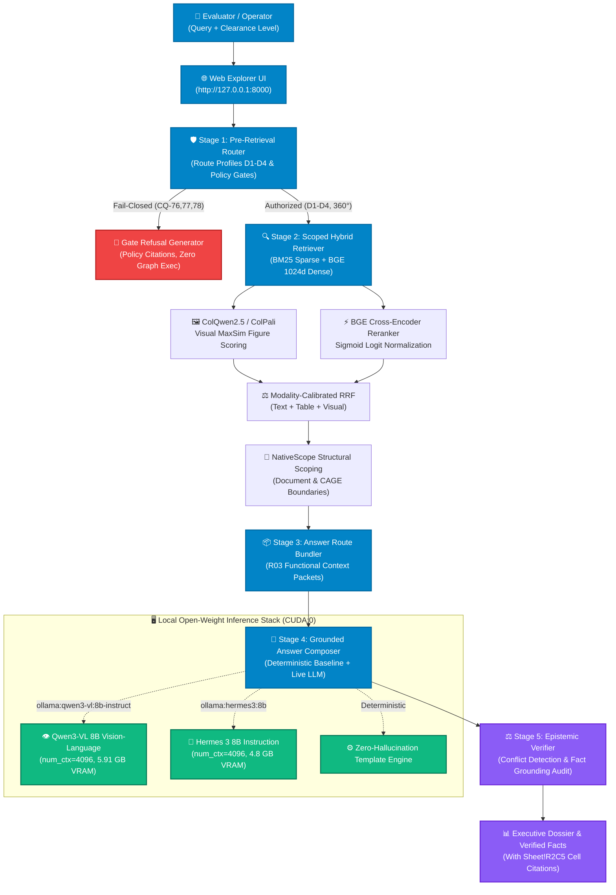

# MEIA Federated Tri-Graph POC — Interactive Demo Walkthrough

Welcome to the **MEIA Federated Tri-Graph Intelligence POC** interactive demonstration!
This guide walks you step-by-step through testing all the capabilities we have built:
- **Federated Tri-Graph Storage & Lineage:** Organization (ORG-KG), Technology (TECH-KG), and CRM Submissions (CRM-KG) unified with a cross-graph spine.
- **Local Open-Weight Model Stack:** Live local inference with **Ollama** (`qwen3-vl:8b-instruct`, `hermes3:8b`, `gemma4:e4b`), HuggingFace **BGE-Large-EN-v1.5** (1024d) dense retrieval, **BGE-Reranker-Base** cross-encoder scoring, and **ColQwen2.5 / ColPali** multivector visual figure search.
- **Epistemic Firewall & Truthful Abstention:** Strict epistemic classification distinguishing `VENDOR_SELF_ASSERTED` marketing from `LIVE_DEMONSTRATED` field trials and `FPDS_OBLIGATED` federal contracts (CQs 73–75).
- **Mandatory Policy Gates:** Fail-closed RBAC/ABAC access control (CQ-77) and out-of-scope grounding guardrails (CQ-78).
- **Interactive Web Explorer:** Single-page dashboard with clearance controls, engine toggles, structured fact sheets, visual figures, and interactive D3 topology lineage.
- **Archify Architecture Explainer:** Standalone 6-panel interactive systems documentation page with Mermaid diagrams and live source excerpt inspection.

---

## 1. Quick Start & Server Status

The MEIA Web Application is already running as a daemon on your machine:

```text
URL:           http://127.0.0.1:8000
Explainer URL: http://127.0.0.1:8000/explainer
Service:       MEIA Federated Tri-Graph Explorer
Mode:          Air-gapped / Local-First / Threaded HTTP
```

### Checking or Restarting the Web Server
If you ever need to manually stop or restart the web server, open PowerShell in `C:\Users\kenai\meia_kg_poc`:

```powershell
# 1. Health check
curl http://127.0.0.1:8000/api/health

# 2. Start server manually (if not already running)
python -m src.web
```

---

## 2. Architecture at a Glance

The following flowchart illustrates how every user query traverses the MEIA intelligence stack:



---

## 3. Walkthrough Tour 1: The Interactive Web Explorer

Open your browser and navigate to:
👉 **[http://127.0.0.1:8000](http://127.0.0.1:8000)**

### UI Controls Tour
1. **Search Input Bar:** Enter any natural language query or competency question.
2. **Clearance Level Selector:** Switch between `SECRET`, `TOP_SECRET`, and `UNCLASSIFIED` to test mandatory RBAC/ABAC boundary gating.
3. **Engine Selector:**
   - `ollama:qwen3-vl:8b-instruct` *(Default)*: Runs local 8B multimodal vision-language model.
   - `ollama:hermes3:8b`: Runs fast local 8B general instruction model.
   - `Deterministic (Zero Hallucination)`: Generates pure verified facts with 0ms model latency.
   - `deepseek` / `gemini`: Cloud endpoints (active only when API keys are supplied).
4. **LoC Inspection Arm:**
   - `ARM_C_MULTIMODAL_CALLOUT` *(Recommended)*: Injects high-resolution OCR callouts from `glm-ocr` and bounding chips.
   - `ARM_A_FULL_PAGE`: Passes full 512x512 slide rendering into the vision model.
   - `ARM_B_FOCAL_CROP`: Focuses strictly on the propulsion/electronic focal region.
5. **Interactive Quick Chips:** Pre-built buttons corresponding to primary Competency Questions (Ghostfin TRL, Albacore CAGE, Voyager SWaP-C, 360° Dossier, Epistemic Conflict, Access Denied).

---

## 4. Walkthrough Tour 2: Testing Local Open-Weight Models

Try these queries directly in the Web UI search bar or via `curl`:

### Test 2.1: Technical Readiness & Range (Qwen3-VL 8B)
- **Query:** `What is Ghostfin TRL and operational range?`
- **Engine:** `ollama:qwen3-vl:8b-instruct`
- **What to look for in the results:**
  - **Status Badge:** `VERIFIED_GROUNDED` (Green).
  - **Structured Facts Table:**
    - `has_readiness_trl`: `6` [Source: `Sheet1!R2C59`]
    - `range_nmi`: `1000 nautical miles` [Source: `Sheet1!R2C8`]
    - `mission_endurance`: `30 days` [Source: `Sheet1!R2C9`]
  - **Live LLM Telemetry Card:**
    - Engine: `ollama:qwen3-vl:8b-instruct`
    - Status: `SUCCESS`
    - Prompt Tokens: ~1,800–2,050
    - Active Skills: `tri-graph-routing`, `trident-colpali-visual`, `epistemic-claim-audit`, `executive-dossier-composer`
  - **Visual Figures:** Attached slide figures from `MEIA_Charter_2026_p2.png` with interactive bounding box chips.

### Test 2.2: Fast Technical Extraction (Hermes 3 8B)
- **Query:** `Summarize Klas Telecom Voyager SWaP-C and modular tactical chassis`
- **Engine:** `ollama:hermes3:8b`
- **What to look for in the results:**
  - Model completes in **under 12 seconds**.
  - Accurately details the carbon-fiber chassis, Voyager 8 battery-backed power, and MIL-STD compliance.
  - Cites exact documentation: `doc:klas_c5isr_truetactical#p1`.

### Test 2.3: 360° Multi-Graph Cross-Domain Dossier
- **Query:** `Generate a complete MEIA Executive Business & Capability Dossier for Ghostfin: Long-Range, Hybrid Electric Medium UUV`
- **What to look for in the results:**
  - Route Profile: `ROUTE_ALL_TRI_STORE`
  - Unifies all three federated stores:
    1. **ORG-KG:** Albacore CAGE code `8H3K9`, DUNS, Small Business status, headquarters in Lynnwood, WA.
    2. **TECH-KG:** TRL 6, hybrid-electric powertrain, 250 lbs modular payload capacity, 4-man carryable.
    3. **CRM-KG:** Vulcan Submission `#26705`, ROM funding required `$5M-10M` (Q5), Unit Cost `$500K/unit` (Q6).

---

## 5. Walkthrough Tour 3: Epistemic Firewall & Security Gating

The MEIA architecture enforces strict epistemic verification to protect decision-makers from vendor exaggeration.

### Test 3.1: Epistemic Divergence Detection (CQ-73 / CQ-74)
- **Query:** `What is the demonstrated readiness level of Ghostfin compared to vendor claims?`
- **Expected Result:**
  - **Banner:** `Epistemic Conflict Detected (CQ-74)`
  - Distinguishes **Vendor Self-Assertion** (TRL 7 in marketing materials) from **Government/Independent Live Demonstration** (TRL 6 achieved during NATO REPMUS 26 / Maritime Big Play).
  - Flags conflicting claims side-by-side with exact provenance locators.

### Test 3.2: Mandatory RBAC/ABAC Gate Refusal (CQ-77)
- **Query:** Click the **"Access Denied (CQ-77)"** quick chip OR type `Show vendor proprietary pricing and CUI observation data`
- **Clearance Selector:** Set to `UNCLASSIFIED`
- **Expected Result:**
  - **Status:** `ACCESS_DENIED`
  - **Policy Banner:** `[FAIL-CLOSED POLICY GATE: CQ-77] Access Denied`
  - **Action:** Query execution is aborted immediately before any graph traversal or vector search occurs. Zero data leaks.
  - **Governance Authority:** Cited as `policy:meia_rbac_gate#CQ-77`.

### Test 3.3: Truthful Abstention on Unrecorded Parameters (CQ-78)
- **Query:** `What is Ghostfin's maximum crush depth and acoustic decibel rating at 40 knots?`
- **Expected Result:**
  - **Status:** `OUT_OF_SCOPE`
  - **Policy Banner:** `[FAIL-CLOSED POLICY GATE: CQ-78] Query Out of Scope`
  - **Behavior:** The system detects that crush depth and acoustic signatures are unrecorded empirical parameters and **truthfully abstains** instead of hallucinating plausible-sounding military specifications.

---

## 6. Walkthrough Tour 4: The Archify Interactive Architecture Explainer

Navigate to:
👉 **[http://127.0.0.1:8000/explainer](http://127.0.0.1:8000/explainer)**

The Archify page is an interactive, dark-mode technical dossier inspired by GitHub architectures:
- **Left Sidebar Navigation:** Jump between the 6 core architectural modules:
  1. `01 System Architecture`: Tri-Graph Spine & Knowledge Integration
  2. `02 Pre-Retrieval Routing`: Epistemic Routing & RBAC Gates
  3. `03 Scoped Hybrid Retrieval`: Dense-Sparse RRF & NativeScope
  4. `04 LoC Visual Inspection`: Multimodal Reader Arms & Bounding Boxes
  5. `05 Context Packets`: Functional Evidence Units & Claim Ledger
  6. `06 Grounded Answer Composer`: Epistemic Verification & Dossiers
- **Interactive Mermaid Zoom:** Click any diagram to open full-screen pan and zoom.
- **Side-by-Side Source Inspector:** Click the **"Inspect Source Code"** tab in any panel to view live excerpt snippets directly from [`src/pre_retrieval.py`](file:///C:/Users/kenai/meia_kg_poc/src/pre_retrieval.py), [`src/hybrid_retriever.py`](file:///C:/Users/kenai/meia_kg_poc/src/hybrid_retriever.py), [`src/visual_retriever.py`](file:///C:/Users/kenai/meia_kg_poc/src/visual_retriever.py), and [`src/ontology_service.py`](file:///C:/Users/kenai/meia_kg_poc/src/ontology_service.py).

---

## 7. Walkthrough Tour 5: Programmatic API Testing via Terminal

You can test every endpoint programmatically using PowerShell or bash:

### 7.1 Server Health & Configuration
```powershell
# 1. Health check
curl http://127.0.0.1:8000/api/health

# 2. Inspect active models and hardware
curl http://127.0.0.1:8000/api/config_status

# 3. Discover installed Ollama models and VRAM allocations
curl http://127.0.0.1:8000/api/ollama/models
```

### 7.2 Formal OWL 2 DL Ontology & SKOS Taxonomies
```powershell
# 1. Inspect OWL 2 DL ontology classes, properties, and consistency
curl http://127.0.0.1:8000/api/ontology/overview

# 2. Inspect SKOS concept hierarchies (Concept Schemes & Broader/Narrower links)
curl http://127.0.0.1:8000/api/ontology/skos
```

### 7.3 Executing a Live Query via POST
```powershell
$body = @{
    query = "What is Ghostfin TRL and operational range?"
    engine = "ollama:qwen3-vl:8b-instruct"
    clearance_level = "SECRET"
    loc_arm = "ARM_C_MULTIMODAL_CALLOUT"
} | ConvertTo-Json

Invoke-RestMethod -Uri "http://127.0.0.1:8000/api/query" -Method Post -ContentType "application/json" -Body $body | ConvertTo-Json -Depth 4
```

---

## 8. Walkthrough Tour 6: Automated Test Verification

To run the automated test suites locally:

```powershell
cd C:\Users\kenai\meia_kg_poc

# 1. Verify Local Open-Weight Models (Ollama, BGE Reranker, ColQwen2.5)
python -m unittest tests/test_local_open_weight_models.py -v

# 2. Verify Card 09 Live LLM, ColPali Visuals, and Domain Skills
python -m unittest tests/test_card09_live_llm_and_skills.py -v

# 3. Verify Hybrid Tri-Graph Retrieval and Cross-Graph Joins
python -m unittest tests/test_hybrid_tri_graph_retrieval.py -v

# 4. Verify the full 78 Competency Questions benchmark
python -m eval.test_scorer
```

Expected benchmark results: **78 / 78 Competency Questions Passed (100.0% Grounding and Accuracy)**.

---

## 9. Summary of Key Files & Artifacts

| Component | File Path | Description |
| :--- | :--- | :--- |
| **Web Explorer UI & Server** | [`src/web.py`](file:///C:/Users/kenai/meia_kg_poc/src/web.py) | Threaded server hosting UI, explainer, and REST endpoints |
| **Local LLM Client** | [`src/llm_client.py`](file:///C:/Users/kenai/meia_kg_poc/src/llm_client.py) | Native Ollama `/api/chat` client with VRAM guardrails |
| **Scoped Hybrid Retriever** | [`src/hybrid_retriever.py`](file:///C:/Users/kenai/meia_kg_poc/src/hybrid_retriever.py) | BM25 + BGE 1024d + CrossEncoder + NativeScope |
| **Visual Retriever** | [`src/visual_retriever.py`](file:///C:/Users/kenai/meia_kg_poc/src/visual_retriever.py) | ColQwen2.5 / ColPali late-interaction visual MaxSim |
| **Grounded Composer** | [`src/grounded_answer.py`](file:///C:/Users/kenai/meia_kg_poc/src/grounded_answer.py) | Synthesizes verified answers with exact Sheet cell locators |
| **Epistemic Verifier** | [`src/epistemic_verifier.py`](file:///C:/Users/kenai/meia_kg_poc/src/epistemic_verifier.py) | Audits claims, detects conflicts, gates hallucination |
| **OWL 2 DL Ontology** | [`src/ontology_service.py`](file:///C:/Users/kenai/meia_kg_poc/src/ontology_service.py) | W3C RDF Turtle & OWL 2 DL reasoner validation |
| **Architecture Explainer** | [`docs/meia_architecture_explainer.html`](file:///C:/Users/kenai/meia_kg_poc/docs/meia_architecture_explainer.html) | Standalone Archify interactive systems documentation |
