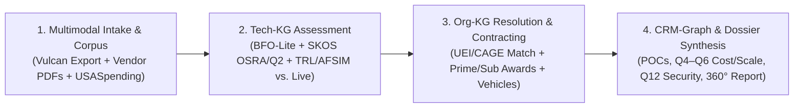
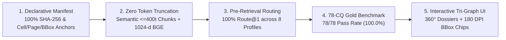

# Project Goal: MEIA Federated Tri-Graph Multimodal NLQ & Epistemic Decision System

**Mission Target:** OUSD(R&E) Mission Engineering and Integration Activity (MEIA) — Technology Scouting, Assessment & Procurement Pathway Intelligence  
**Architectural Reference:** [`kaiello/aws-a30-prototype/docs`](https://github.com/kaiello/aws-a30-prototype/tree/main/docs) (Dual-Layer Epistemic Graph + Context-Bench Answer Routes + Active Pre-Retrieval Routing)  
**Benchmark Standard:** 78 Federated Competency Questions (`CQ-01` – `CQ-78`) across `Org-KG`, `Tech-KG`, and `CRM-Graph`  
**Status:** Proposed Goal Specification for Review Prior to Repository Commit  

---

## 1. Executive Summary & Objective

The objective of the **MEIA Federated Tri-Graph Multimodal NLQ Prototype** is to build an authoritative, fully auditable, multimodal Natural Language Query (NLQ) and Epistemic Decision System capable of searching, retrieving, and synthesizing verified answers **within any of three domain graphs (`Org-KG`, `Tech-KG`, `CRM-Graph`) or across all three graphs simultaneously** to answer all **78 MEIA Competency Questions (`CQ-01` – `CQ-78`)**.

In defense technology scouting and mission engineering, answering a single operational question—*“Which organizations have a relevant capability, what supports that claim, how mature is it empirically, what commercial/security constraints apply, and how can DoD/federal sponsors procure it?”*—requires fusing multimodal evidence that generic RAG systems routinely conflate or hallucinate:
1. **Vendor Intake Submissions & Commercial Observations** (e.g., `MEIA_TEM_Vulcan_Export.xlsx` covering `Q1`–`Q12`: JOP alignment, unit cost, ROM funding to scale, supply constraints, IP/ITAR, and meeting security level).
2. **Multimodal Technical Briefs, Vector Schematics & Raster Slide Decks** (e.g., native vector and scanned image-only PDFs in `Company Data`, requiring 180 DPI rendering, OCR/VLM layout parsing, and interactive bounding-box callout chips).
3. **Empirical Readiness vs. Self-Asserted Marketing Claims** (strictly separating a vendor's `CapabilityClaim` in a brochure or Vulcan form from an empirical `DemonstrationEvent` such as an **AFSIM** constructive simulation, a live military exercise like `SONIC SPEAR 26`, or an SME-reviewed `TMTR` evaluation).
4. **Verified Federal Industrial Base & Procurement Pathways** (e.g., `SAM.gov` entity registrations (`UEI`, `CAGE`, `DUNS`) and `USASpending.gov` / `FPDS` prime/sub obligation histories, NAICS/PSC classifications, sole-source vs. competed awards, and pre-competed contract vehicles).

By adapting the **Dual-Layer Epistemic Graph**, **Declarative Source Manifest**, and **Two-Stage Hybrid Pre-Retrieval** architecture from `aws-a30-prototype`, this project guarantees:
- **Minimum-Sufficient Pre-Retrieval Graph Routing** across standalone (`ROUTE_ORG`, `ROUTE_TECH`, `ROUTE_CRM`), pairwise (`ROUTE_ORG_TECH`, `ROUTE_CRM_ORG`, `ROUTE_CRM_TECH`), and full 360° dossier (`ROUTE_ALL_TRI_STORE`) query profiles.
- **Unbroken Epistemic Provenance** where every asserted fact traces mathematically to an immutable `:EvidenceNode` (`Workbook!Sheet!R:C`, PDF page + normalized `[ymin, xmin, ymax, xmax]` BBox, or SHA-256 `USASpending` API receipt).
- **Strict Claim-vs-Demonstration Non-Equivalence** and **Fail-Closed Abstention** on out-of-scope, unrecorded, or policy-restricted (`RBAC`/`ABAC`) queries.

---

## 2. End-to-End Pilot Workflow & Client Verification Tests

The system operationalizes the complete MEIA decision workflow without duplicating the CRM's master operational role or promoting unverified vendor claims to accepted facts:

### Client Test 1: Technology Field Normalization & Claim-vs-Demonstration Evaluation (`Tech-KG` + `CRM-Graph`)
Demonstrate that raw product/capability submissions and multimodal vendor briefs are transformed into reviewed, taxonomy-aligned technical assessments while preserving raw source evidence:
- Preserve original fields (`name`, `description`, `differentiator`, `Q1`–`Q12`) as immutable source evidence anchored to exact Excel cells and PDF bounding boxes.
- Derive normalized **SKOS** classifications (`OSRA 2021` `TBB` codes and `MEIA Topic Areas`), **BFO-Lite** categories (`Product`, `Service`, `Technology`, `CapabilityClaim`, `DemonstrationEvent`), dated `ReadinessAssessment` records (`TRL`, `MRL`, `IRL`), and `CommercialObservation` records (`ROM Funding Q5`, `Unit Cost Q6`, `Supply Constraints Q4`).
- Explicitly distinguish **vendor-stated claims** (`VENDOR_SELF_ASSERTED`) from **demonstrated performance** (`AFSIM_SIMULATED`, `LIVE_EXERCISE_DEMONSTRATED`, `SME_REVIEWED`).

### Client Test 2: Trusted Organization & Procurement Pathway Aggregation (`Org-KG` + Cross-Graph Joins)
Demonstrate that CRM accounts, Vulcan submissions, multimodal capability briefs, and federal procurement feeds (`SAM.gov` and `USASpending.gov`) assemble into a single **360° Executive Business & Capability Dossier** (`CQ-68` – `CQ-72`):
- Match organizations strictly via stable identifiers (`UEI`, `CAGE`, `DUNS`, or `CRM_ID`) or documented human review—**never by fuzzy name matching alone**.
- Separate list price, unit cost (`Q6`), ROM scaling estimate (`Q5`), and obligated federal contract awards (`USASpending` prime/sub history) as distinct, dated observations with explicit provenance.

---

## 3. Core Scope & Corpus Boundaries

### 3.1 In-Scope Multimodal Assets (POC Seed Corpus)
1. **Structured Intake & Schema Exports**:
   - `MEIA_TEM_Vulcan_Export.xlsx`: All 62 columns across the three populated vendor capability submissions:
     - **Albacore Inc.** (`CAGE: 0QSF0`, Vulcan ID `26705`) — *Ghostfin: Long-Range, Hybrid Electric Medium UUV*.
     - **Voltage Vessels** (`CAGE: 9W2W3`, Vulcan ID `25615`) — *Eclipse X9: High-Speed Group 3 UAS*.
     - **T2S Solutions, LLC** (Vulcan ID `27268`) — *Counter Sensing: Multi-Domain EW / C-ISR Architecture*.
   - `CRM_Object_Field_Mapping.xlsx`: Twenty CRM custom object definitions (`Organizations`, `Submissions`, `Technologies`, `Assessments`), field dispositions (`CANONICAL`, `SOURCE_ONLY`, `REVIEW`, `EXCLUDED`), and encryption rules.
2. **Governance, Charter & Portal Baselines**:
   - `MEIA Charter - 2026.pdf`: OUSD(R&E) charter authority, Joint Operational Problem (`JOP`) framing, and multi-agency transition pathways.
   - `https://www.meia.mil/` and `https://www.meia.mil/faq/`: Official topic areas, 48-hour triage SLA rules, and `VERDICT` submission workflows.
3. **Multimodal Vendor Technical Briefs (`Company Data/*.pdf`)**:
   - Native vector & text PDFs: `KLAS_Customer_Deck.pdf`, `T2S_Capabilities_Brief.pdf`, etc.
   - Raster/image-only PDFs (`0` native text chars, requiring 180 DPI rendering + `Docling`/OCR/VLM bounding-box extraction): `Prometheus_Energy_AI.pdf` (*Prometheus Torch*), `Fluor_Government_Overview.pdf` (*Fluor Federal Services*).
4. **Authoritative Federal Procurement Snapshots (`SAM.gov` & `USASpending.gov`)**:
   - Verified UEI/CAGE/DUNS registrations, NAICS/PSC profiles, and prime/sub-award obligation histories for **Fluor Federal Services (`UEI: NZ9CUMF36PK1`)**, **KLAS Government (`UEI: L3T9VHGP44D1` / `KQ28QJU21GY3`)**, **Prometheus Intelligence (`UEI: J767K9B843S5` — FAA Single-Source Award `697DCK-24-C-00237`)**, **Albacore (`CAGE: 0QSF0`)**, **Voltage Vessels (`CAGE: 9W2W3`)**, and **T2S Solutions**.

### 3.2 Out-of-Scope & Fail-Closed Abstention Boundary (`CQ-73` – `CQ-78`)
The system enforces deterministic negative controls and must fail closed without guessing or fabricating values when presented with:
1. **Unrecorded Quantitative Parameters (`CQ-78`)**: E.g., asking for the acoustic target strength in decibels of *Ghostfin* or specific flight ceiling metrics not present in the approved corpus $\rightarrow$ returns `NOT_RECORDED` / `TRUTHFUL_ABSTENTION`.
2. **Claim-as-Fact Promotion (`CQ-75`)**: Queries asking for "proven/validated" capabilities when only a vendor brochure or Vulcan self-assertion exists $\rightarrow$ returns `UNVERIFIED_VENDOR_CLAIM` and refuses to certify empirical validation.
3. **Conflicting Source Assertions (`CQ-74`)**: When a vendor PDF claims `TRL 8` but the Vulcan intake or SME review records `TRL 6` $\rightarrow$ returns both values with `CONFLICTING_EVIDENCE` provenance rather than silently overwriting either record.
4. **Policy-Restricted PII, Pricing & Security Fields (`CQ-77`)**: Requests from unauthorized roles for encrypted POC emails, unit pricing (`Q6`), or `TS/SCI` meeting details (`Q12`) $\rightarrow$ returns `ACCESS_DENIED_REDACTED`.
5. **Undeployed Graph Modules (`CQ-76`)**: Cross-graph queries targeting a disabled or unindexed graph partition $\rightarrow$ returns `INSUFFICIENT_DEPLOYED_CAPABILITY` before LLM invocation.

---

## 4. BFO-Lite + SKOS Semantic Discipline

In alignment with the MEIA Ontology Architecture Plan, **Basic Formal Ontology (BFO-Lite)** serves as the semantic guardrail beneath the three domain graphs, while **SKOS** governs all classification schemes:

| MEIA Concept | Target Graph | BFO-Lite / SKOS Interpretation | Epistemic Guardrail |
| :--- | :---: | :--- | :--- |
| **Organization / Company** | `Org-KG` | Enduring application-domain entity (`meia:Organization`) | Matched only via `UEI`, `CAGE`, `DUNS`, or reviewed ID. |
| **Physical Product / Platform** | `Tech-KG` | Independent continuant / material entity (`meia:Product`) | Distinct from the capability it claims or technology it uses. |
| **Software / Algorithm** | `Tech-KG` | Generically dependent continuant / information artifact (`meia:Service` / `meia:Offering`) | Versioned separately from hardware hosts (`Q10`). |
| **OSRA `TBB` / MEIA Topic (`Q2`)** | `Tech-KG` | `skos:Concept` in versioned `skos:ConceptScheme` | Linked via `meia:classifiedAs`, never `rdf:type`. |
| **Vendor Capability Assertion** | `Tech-KG` / `CRM-Graph` | Information artifact (`meia:CapabilityClaim`) | Status defaults to `PROPOSED` / `VENDOR_SELF_ASSERTED`. |
| **AFSIM Run / Live Exercise** | `Tech-KG` | Process / occurrent (`eval:DemonstrationEvent`) | Distinct from the `AssessmentRecord` documenting it. |
| **TRL / MRL / IRL (`Q9`)** | `Tech-KG` | Dated `meia:ReadinessAssessment` pointing to `skos:Concept` (`trl:TRL6`) | Never a timeless scalar property on an Organization. |
| **Unit Cost (`Q6`) / ROM (`Q5`)** | `CRM-Graph` | Dated `meia:CommercialObservation` | Separates quote, ROM estimate, unit cost, and FPDS award obligation. |
| **Vendor POC / Gov Reviewer** | `CRM-Graph` | `meia:Role` borne by a `meia:Person` in a submission context | PII remains field-encrypted and permission-gated. |

---

## 5. Measurable Success Criteria & Verification Gates

| Verification Gate | Target Metric | Measurement Protocol |
| :--- | :---: | :--- |
| **1. Corpus & Manifest Completeness** | **100%** of Vulcan cells, PDF pages, raster scans, and API receipts | `python -B tests/test_meia_manifest.py` verifies SHA-256 digests, cell coordinates, and 180 DPI PNG bindings. |
| **2. Zero Silent Vector Truncation** | **0.0%** token loss across all text chunks | All chunks $\le 400$ tokens encoded via `BAAI/bge-large-en-v1.5` (512-token window, 1024-dim). |
| **3. Pre-Retrieval Routing Accuracy (`Route@1`)** | **100% (78/78)** assigned to minimum-sufficient graph profile | Verifies `ROUTE_ORG`, `ROUTE_TECH`, `ROUTE_CRM`, pairwise joins, `ROUTE_ALL_TRI_STORE`, and `FAIL_CLOSED_GATE`. |
| **4. Context-Bench `Evidence Recall@5`** | **$\ge 98.0\%$** complete Answer Route recovery | Evaluates retrieval of primary claims + supporting Excel cells, PDF chunks, 180 DPI figures, and award receipts. |
| **5. Claim-vs-Demonstration Separation** | **100%** non-conflation rate | Zero vendor self-assertions (`CapabilityClaim`) mislabeled as empirical `DemonstrationEvent` or `FPDS` proof. |
| **6. Gold 78-CQ Benchmark Accuracy** | **78/78 (100.0%)** across all 8 profiles | Automated evaluation via `eval/test_scorer.py --benchmark eval/gold_78_cqs.json`. |
| **7. Fail-Closed & Abstention Precision** | **6/6 (100.0%)** on `CQ-73` – `CQ-78` | Verifies exact locators, conflict preservation, RBAC redaction, and truthful abstention. |
| **8. Infrastructure Footprint** | **Zero external DB daemons** | Pure local SQLite `FTS5` + NetworkX `GraphML` + contextual vector projections. |

---

## 6. Architectural Non-Goals

1. **No Unreviewed Write-Back to Production Twenty CRM**: The semantic layer ingests CRM exports/snapshots and proposes reviewed enrichments; it never overwrites operational CRM master records without explicit steward approval.
2. **No Full OWL Theorem Prover Lock-In**: BFO-Lite and SKOS rules are enforced deterministically via Python contracts, SQLite foreign keys, and SHACL shapes rather than brittle runtime OWL DL reasoners.
3. **No Heavy Standalone Server Dependencies for the Prototype**: Avoids mandatory Docker clusters, Neo4j enterprise daemons, or cloud vector DB subscriptions during prototype evaluation.
4. **No Post-Hoc Ontology Decoration**: Ontology resolution, acronym expansion, and graph routing must steer candidate retrieval *before* generation, never act as cosmetic post-generation regex filters.

---

## 7. Milestone Delivery Roadmap (`Card 01` – `Card 08`)

- [ ] **Card 01: Declarative Corpus Manifest & Clean-Slate Scaffold (`config/meia_poc_manifest.json`)**: Fingerprint all Excel workbooks, native/raster PDFs, web snapshots, and `USASpending`/`SAM.gov` JSON payloads with exact page/sheet/cell/bbox schemas.
- [ ] **Card 02: Multimodal Extraction & Raster OCR/Diagram Pipeline (`src/extract.py`)**: Extract Vulcan `Q1`–`Q12` cells, render 180 DPI PNGs for all vendor slides/diagrams (including OCR + normalized BBoxes for raster PDFs `Prometheus_Energy_AI.pdf` and `Fluor_Government_Overview.pdf`), and chunk text at $\le 400$ tokens.
- [ ] **Card 03: Federated Tri-Graph + Shared Epistemic Spine Builder (`src/build_tri_graph.py`)**: Project `Org-KG`, `Tech-KG`, `CRM-Graph`, `integration/link_registry/`, and `Evidence-KG` into `storage/meia_tri_graph_registry.db` (SQLite FTS5) and `storage/*.graphml`.
- [ ] **Card 04: Active 1024-d Contextual Vector Indexer (`src/contextual_indexer.py`)**: Encode all chunks and entity descriptions with `BAAI/bge-large-en-v1.5` prepended with `[GRAPH | ENTITY | SOURCE | SECURITY]` headers—zero token truncation.
- [ ] **Card 05: Pre-Retrieval Intent Router & Two-Stage Hybrid Retriever (`src/pre_retrieval.py`, `src/hybrid_retriever.py`)**: Implement deterministic routing across the 8 CQ profiles, SKOS/acronym expansion, SQLite FTS5 + BGE-large RRF fusion, and local Cross-Encoder reranking.
- [ ] **Card 06: Answer Route Bundler, Grounded Composer & Epistemic Verifier (`src/answer_routes.py`, `src/grounded_answer.py`, `src/epistemic_verifier.py`)**: Assemble multimodal Answer Routes, compose 360° vendor dossiers (`CQ-68`–`CQ-72`), and enforce Claim-vs-Demonstration and Fail-Closed gates (`CQ-73`–`CQ-78`).
- [ ] **Card 07: Interactive Tri-Graph Visual Explorer & 360° Dossier UI (`src/web.py`)**: Deliver the single-page web application with graph-route badges, 360° Executive Dossier cards, and 180 DPI diagram lightbox with clickable BBox callout chips.
- [ ] **Card 08: 78-CQ Gold Benchmark Harness & Guarded Verification Receipt (`eval/test_scorer.py`, `eval/gold_78_cqs.json`)**: Execute full offline and live evaluation across all 78 Competency Questions and publish the verification receipt.
