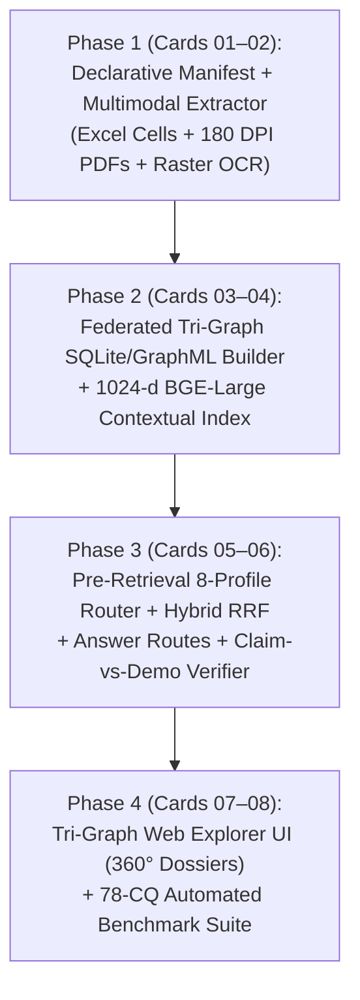

# Implementation Plan: MEIA Federated Tri-Graph Multimodal NLQ & Epistemic Decision Prototype

**Target System:** MEIA Federated Tri-Graph Multimodal NLQ & Epistemic Decision System (`Org-KG`, `Tech-KG`, `CRM-Graph`)  
**Architectural Reference Baseline:** [`kaiello/aws-a30-prototype/docs`](https://github.com/kaiello/aws-a30-prototype/tree/main/docs)  
**Benchmark Coverage:** 78 Federated Competency Questions (`CQ-01` – `CQ-78`)  
**Date:** 2026-10-18  
**Status:** Proposed Implementation Plan for Review Prior to Repository Commit  

---

## 1. Goal Description

Build a clean, reproducible, multimodal Natural Language Query (NLQ) and Epistemic Decision Prototype capable of searching and retrieving across—or strictly within—MEIA's three federated domain graphs (**Organization Graph `Org-KG`**, **Technology Graph `Tech-KG`**, and **CRM Graph `CRM-Graph`**) to answer any of the **78 Federated Competency Questions (`CQ-01` – `CQ-78`)**.

The implementation directly reuses the proven architectural building blocks of [`kaiello/aws-a30-prototype`](https://github.com/kaiello/aws-a30-prototype/tree/main/docs)—specifically its **Dual-Layer Epistemic Graph**, **Declarative Source Manifest**, **180 DPI Multimodal Asset & Callout Chip Registry**, **Context-Bench Answer Route Bundler**, and **Auditable Epistemic Verifier**—while eliminating upfront the six runtime bottlenecks diagnosed in [`nlq_search_retrieval_recommendations.md`](https://github.com/kaiello/aws-a30-prototype/blob/main/docs/nlq_search_retrieval_recommendations.md):
1. **Declarative Manifest First (`config/meia_poc_manifest.json`)**: Every Excel workbook, vendor PDF, web snapshot, and `USASpending`/`SAM.gov` JSON receipt is SHA-256 fingerprinted and mapped to canonical element IDs before ingestion.
2. **Zero Silent Vector Truncation**: Replaces 384-dim `all-MiniLM-L6-v2` (256-token limit) with field/section-aligned chunking ($\le 400$ tokens) and active **1024-dim `BAAI/bge-large-en-v1.5`** contextual embeddings (512-token window).
3. **100% Multimodal & Raster PDF Coverage**: Eliminates artificial figure caps (`max_figures=40`) and adds `180 DPI` rendering + `Docling`/OCR/VLM bounding-box extraction for rasterized image PDFs (`Prometheus_Energy_AI.pdf` and `Fluor_Government_Overview.pdf`).
4. **Pre-Retrieval Tri-Graph Routing (`src/pre_retrieval.py`)**: Executes entity resolution, SKOS/acronym expansion, RBAC/ABAC policy checks, and minimum-sufficient graph routing (`ROUTE_ORG`, `ROUTE_TECH`, `ROUTE_CRM`, pairwise joins, `ROUTE_ALL_TRI_STORE`, `FAIL_CLOSED_GATE`) *before* retrieval and LLM generation.
5. **Claim-vs-Demonstration Non-Equivalence (`src/epistemic_verifier.py`)**: Enforces a hard epistemic boundary between vendor self-assertions (`meia:CapabilityClaim`) and empirical demonstrations (`eval:DemonstrationEvent` via AFSIM, live military exercises, or FPDS contract performance).
6. **Zero Synthetic Test Leakage**: Evaluates strictly against genuine extracted records from `MEIA_TEM_Vulcan_Export.xlsx`, `CRM_Object_Field_Mapping.xlsx`, `MEIA Charter - 2026.pdf`, `Company Data/*.pdf`, and verified `USASpending.gov` / `SAM.gov` API receipts.

---

## 2. Architectural Review & Key Design Decisions

> [!IMPORTANT]
> **1. Three Federated Domain Graphs over One Shared Epistemic Spine**:
> Rather than building three isolated RAG silos (which cannot execute cross-graph joins `CQ-51`–`CQ-72`) or collapsing everything into a single undifferentiated graph (which violates client domain boundaries), the prototype stores **`Org-KG`**, **`Tech-KG`**, and **`CRM-Graph`** as distinct graph namespaces (`org:`, `tech:`, `crm:`) with dedicated SQLite `FTS5` indices (`org_fts`, `tech_fts`, `crm_fts`) and standalone `.graphml` exports, joined exclusively through the **Cross-Graph Link Registry (`cross_graph_links`)** and grounded in the shared **Multimodal Evidence Graph (`evidence_nodes` + `claim_ledger`)**.

> [!IMPORTANT]
> **2. Handling Raster-Only Vendor PDFs (`Prometheus` & `Fluor`)**:
> Corpus inspection confirmed that `Prometheus_Energy_AI.pdf` and `Fluor_Government_Overview.pdf` in `Company Data` have `0` selectable native text characters (scanned/rasterized slides). `src/extract.py` automatically detects zero-text pages, renders them at **180 DPI**, runs `Docling` / local VLM (`qwen3-vl:8b-instruct` or `Tesseract` OCR) to extract structured text and normalized `[ymin, xmin, ymax, xmax]` bounding boxes, and binds every extracted claim to its exact visual page region.

> [!WARNING]
> **3. Windows File-Lock Safe Excel Ingestion**:
> Because `MEIA_TEM_Vulcan_Export.xlsx` and `CRM_Object_Field_Mapping.xlsx` may be open in Excel on the host workstation, `src/extract.py` reads from a verified read-only snapshot copy validated against the manifest's SHA-256 digest, preventing `PermissionError` lock failures during extraction.

---

## 3. Repository & Directory Structure

Following the layout of [`kaiello/aws-a30-prototype`](https://github.com/kaiello/aws-a30-prototype), the project is structured as follows:

```text
meia-tri-graph-prototype/
├── config/
│   ├── meia_poc_manifest.json             # Authoritative SHA-256, sheet/cell, PDF page & API receipt manifest
│   └── skos_schemes.json                  # OSRA 2021 TBB, MEIA Q2 Topics, TRL/MRL/IRL, Claim/Review schemes
├── data/                                  # Read-only fingerprinted source inputs (gitignored where restricted)
│   ├── MEIA_TEM_Vulcan_Export.xlsx
│   ├── CRM_Object_Field_Mapping.xlsx
│   ├── MEIA_Charter_2026.pdf
│   ├── company_data/                      # KLAS, T2S, Prometheus, Fluor, etc. PDFs
│   └── federal_feeds/                     # Verified USASpending & SAM.gov JSON receipts
├── docs/
│   ├── architecture.md                    # System architecture & Tri-Graph + Dual-Layer specification
│   ├── goal.md                            # Project goals, BFO-Lite + SKOS rules, & verification gates
│   ├── plan.md                            # This implementation plan
│   └── MEIA_Federated_78_Competency_Questions.md  # Full 78-CQ catalog & routing matrix
├── parsed/
│   ├── vulcan_submissions.jsonl           # Cell-anchored records (Sheet!Row:Col) for Albacore, Voltage, T2S
│   ├── text_chunks.jsonl                  # <= 400-token semantic chunks with [GRAPH|ENTITY|SOURCE] headers
│   ├── tables/                            # Structured Markdown & JSON tables (Vulcan Q1-Q12, FPDS awards)
│   └── figures/                           # 180 DPI PNG renders + figure_bboxes.json ([ymin,xmin,ymax,xmax])
├── storage/                               # Zero-daemon local persistence substrates
│   ├── meia_tri_graph_registry.db         # SQLite DB: domain_nodes, cross_graph_links, claim_ledger, FTS5
│   ├── org_kg.graphml                     # Standalone Organization Graph export
│   ├── tech_kg.graphml                    # Standalone Technology Graph export
│   ├── crm_graph.graphml                  # Standalone CRM Graph export
│   ├── federated_epistemic_graph.graphml  # Combined Tri-Graph + Evidence Graph export
│   ├── vdb_chunks_contextual.json         # 1024-dim BGE-large contextual chunk vectors
│   └── vdb_entities.json                  # 1024-dim BGE-large entity vectors
├── src/
│   ├── __init__.py
│   ├── config.py                          # Paths, model endpoints, embedding/reranker settings
│   ├── standard_manifest.py               # Pure stdlib validator for config/meia_poc_manifest.json
│   ├── extract.py                         # Multimodal extractor (Openpyxl + PyMuPDF 180 DPI + Docling/OCR)
│   ├── build_tri_graph.py                 # Deterministic projector for Org-KG, Tech-KG, CRM-Graph & SQLite
│   ├── contextual_indexer.py              # BGE-large-en-v1.5 (1024-dim) contextual vector builder
│   ├── pre_retrieval.py                   # Stage 1: Intent classifier, 8-profile router, SKOS expander, RBAC gate
│   ├── hybrid_retriever.py                # Stage 2 & 3: Scoped FTS5 BM25 + BGE-large RRF + Cross-Encoder
│   ├── answer_routes.py                   # Stage 3: Multimodal Answer Route & Cross-Graph Join bundler
│   ├── grounded_answer.py                 # Stage 4: Deterministic fact composer & 360° Dossier builder
│   ├── epistemic_verifier.py              # Stage 5: Claim-vs-Demo auditor, conflict & locator verifier
│   ├── figure_inspectors.py               # Interactive 180 DPI diagram & slide callout chip registry
│   ├── query.py                           # Unified NLQ entrypoint (CLI & API)
│   └── web.py                             # Tri-Graph Visual Explorer & 360° Dossier Web UI (Port 8000)
├── eval/
│   ├── gold_78_cqs.json                   # Machine-readable 78-question benchmark with ground-truth anchors
│   └── test_scorer.py                     # Decoupled scorer: Route@1, Recall@5, Claim-vs-Demo, Grounding
└── tests/
    ├── test_meia_manifest.py              # Manifest SHA-256, cell coordinate, and page/bbox validation
    ├── test_pre_retrieval_routing.py      # Tests all 8 routing profiles across CQ-01 to CQ-78
    ├── test_hybrid_tri_graph_retrieval.py # Tests scoped FTS5 + BGE-large RRF & cross-graph link joins
    ├── test_claim_vs_demo_verifier.py     # Adversarial tests for claim-as-fact, conflicts & abstentions
    └── test_web_endpoints.py              # Loopback API, RBAC redaction & asset containment tests
```

---

## 4. Proposed Implementation Components (Step-by-Step)

### Component 1: Declarative Source Manifest & Schema Contract (`config/meia_poc_manifest.json` & `src/standard_manifest.py`)

Directly adapting [`declarative_manifest_plan.md`](https://github.com/kaiello/aws-a30-prototype/blob/main/docs/declarative_manifest_plan.md), we define a closed JSON contract owning all source document identities, SHA-256 digests, sheet/row/column bounds, PDF page maps, raster-OCR requirements, and `USASpending` API receipts:

```json
{
  "schema_version": "1.0.0",
  "manifest_revision": 1,
  "workbooks": [
    {
      "id": "doc:vulcan_export_2026",
      "relpath": "data/MEIA_TEM_Vulcan_Export.xlsx",
      "sha256": "<verified_sha256>",
      "sheets": [
        {
          "sheet_name": "Vulcan",
          "row_count": 4,
          "col_count": 62,
          "populated_records": [
            {"row_index": 2, "vulcan_id": "26705", "org_name": "Albacore Inc.", "cage": "0QSF0", "offering": "Ghostfin: Long-Range, Hybrid Electric Medium UUV"},
            {"row_index": 3, "vulcan_id": "25615", "org_name": "Voltage Vessels", "cage": "9W2W3", "offering": "Eclipse X9"},
            {"row_index": 4, "vulcan_id": "27268", "org_name": "T2S Solutions, LLC", "cage": null, "offering": "Counter Sensing"}
          ]
        }
      ]
    }
  ],
  "documents": [
    {
      "id": "doc:meia_charter_2026",
      "relpath": "data/MEIA_Charter_2026.pdf",
      "modality": "native_pdf",
      "TargetGraph": ["TECH", "CRM"]
    },
    {
      "id": "doc:prometheus_energy_ai",
      "relpath": "data/company_data/Prometheus_Energy_AI.pdf",
      "modality": "raster_pdf_ocr_required",
      "render_dpi": 180,
      "TargetGraph": ["ORG", "TECH"]
    },
    {
      "id": "doc:fluor_gov_overview",
      "relpath": "data/company_data/Fluor_Government_Overview.pdf",
      "modality": "raster_pdf_ocr_required",
      "render_dpi": 180,
      "TargetGraph": ["ORG", "TECH"]
    }
  ],
  "api_receipts": [
    {
      "id": "api:usaspending_vendor_history_2026",
      "relpath": "data/federal_feeds/vendor_history_output.json",
      "entities_covered": ["NZ9CUMF36PK1", "L3T9VHGP44D1", "KQ28QJU21GY3", "J767K9B843S5", "0QSF0", "9W2W3"]
    }
  ]
}
```

---

### Component 2: Multimodal Extraction & Zero-Truncation Chunking (`src/extract.py`)

1. **Spreadsheet Cell Extractor (`Openpyxl`)**:
   - Extracts every populated cell from `MEIA_TEM_Vulcan_Export.xlsx` (`Row 2`, `Row 3`, `Row 4` across all 62 columns) and `CRM_Object_Field_Mapping.xlsx`.
   - Emits cell-level `:EvidenceNode` records with exact `Workbook!Sheet!R<row>C<col>` locators and maps each column to its target graph (`Org-KG`, `Tech-KG`, or `CRM-Graph`) and handling sensitivity (`PUBLIC`, `CUI`, `PII_ENCRYPTED`, `COMMERCIAL_PROPRIETARY`).
2. **PDF Vector & Raster Extractor (`PyMuPDF` + `Docling` + Local OCR/VLM)**:
   - Renders all vendor presentation pages, capability diagrams, and raster pages at **180 DPI** to `parsed/figures/`.
   - Extracts normalized `[ymin, xmin, ymax, xmax]` bounding boxes for diagrams, tables, and callout regions (`parsed/figures/figure_bboxes.json`).
3. **Definition & Field-Boundary Semantic Chunker ($\le 400$ Tokens)**:
   - Splits narrative documents on semantic section and slide boundaries, strictly capped at **400 tokens** with a 50-token overlap.
   - Prepends every chunk with a canonical context header before embedding:
     ```text
     [GRAPH: TECH-KG | ENTITY: Ghostfin UUV (Albacore, CAGE 0QSF0) | SOURCE: MEIA_TEM_Vulcan_Export.xlsx!Vulcan!R2C23 | FIELD: Q3 Capability Contribution]
     ```

---

### Component 3: Federated Tri-Graph + Shared Spine Builder (`src/build_tri_graph.py`)

Deterministically projects the extracted records into `storage/meia_tri_graph_registry.db` (SQLite + `FTS5`) and four NetworkX GraphML files (`org_kg.graphml`, `tech_kg.graphml`, `crm_graph.graphml`, `federated_epistemic_graph.graphml`):
1. **Builds `Org-KG` (`org:`)**: Populates `:Organization` nodes (`Albacore`, `Voltage Vessels`, `T2S Solutions`, `KLAS Government`, `Fluor Federal Services`, `Prometheus Intelligence`), parent lineage (`Fluor Corporation`), `UEI`/`CAGE`/`DUNS`, `NAICS`/`PSC` codes, `USASpending` prime/sub obligation totals, and contract vehicles.
2. **Builds `Tech-KG` (`tech:` / `eval:`)**: Populates `:Offering` (`Product`/`Service`), BFO-Lite categories, SKOS concept bindings (`OSRA 2021` `TBB` + `MEIA Q2 Topic Areas`), `JOP` alignments (`Q1`), quantified warfighter contributions (`Q3`), `SWaP-C`, dated `ReadinessAssessment` (`TRL/MRL/IRL`, `Q9`), `PerformanceMeasure` (`Q7`), `IntegrationInterface` (`Q10`), and explicitly separated `:CapabilityClaim` vs. `:DemonstrationEvent` (AFSIM vs. live exercises like `SONIC SPEAR 26`).
3. **Builds `CRM-Graph` (`crm:`)**: Populates `:CapabilitySubmission`, Twenty CRM pipeline stages, 48-hour SLA timers, field-encrypted `:VendorPOC` records, `:GovernmentStakeholder` assignments (`Sponsor 1`, `Technical 1`, `Regulatory 1`), `Q12` security preferences, dated `:CommercialObservation` records (`Q4` supply constraints, `Q5` ROM funding, `Q6` unit cost, IP/ITAR), and `:TMTRRiskAssessment` scores.
4. **Builds `integration/link_registry/` & `Evidence-KG`**: Populates `cross_graph_links` (`[:DEVELOPS_OFFERING]`, `[:SUBMITTED_BY_ORG]`, `[:EVALUATES_OFFERING]`, `[:VALIDATED_BY_CONTRACT]`) and binds every claim in `claim_ledger` to its `:EvidenceNode` anchors.

---

### Component 4: Active 1024-d Contextual Embeddings & Pre-Retrieval Router (`src/contextual_indexer.py` & `src/pre_retrieval.py`)

1. **Contextual Vector Indexing (`src/contextual_indexer.py`)**:
   - Encodes all $\le 400$-token chunks and entity profiles using `BAAI/bge-large-en-v1.5` (`1024` dimensions, `512` max tokens).
   - Stores each vector in `storage/vdb_chunks_contextual.json` and `storage/vdb_entities.json` tagged with `graph_domain` (`ORG`, `TECH`, `CRM`) and `handling_level` for instant pre-filtered search.
2. **Pre-Retrieval Intent & Minimum-Sufficient Graph Router (`src/pre_retrieval.py`)**:
   - Before any vector search or LLM call, analyzes the user query to:
     - Check **Fail-Closed Gates** (`CQ-76` undeployed module check, `CQ-77` RBAC/ABAC clearance check, `CQ-78` out-of-scope check).
     - Resolve mentioned company names, UEIs, CAGE codes, Vulcan IDs, or offering names against the SQLite entity dictionary.
     - Expand defence acronyms and SKOS synonyms (`UUV`, `C-UAS`, `EW`, `OSRA TBB`, `TRL`, `AFSIM`, `ROM`, `FOCI`).
     - Select the exact **Minimum-Sufficient Routing Profile**:
       - Single-graph: `ROUTE_ORG` (`CQ-01`–`CQ-18`), `ROUTE_TECH` (`CQ-19`–`CQ-36`), or `ROUTE_CRM` (`CQ-37`–`CQ-50`).
       - Pairwise join: `ROUTE_ORG_TECH` (`CQ-51`–`CQ-57`), `ROUTE_CRM_ORG` (`CQ-58`–`CQ-62`), or `ROUTE_CRM_TECH` (`CQ-63`–`CQ-67`).
       - Tri-graph 360° dossier: `ROUTE_ALL_TRI_STORE` (`CQ-68`–`CQ-72`).

---

### Component 5: Two-Stage Hybrid Retrieval, Answer Routes & Epistemic Verifier (`src/hybrid_retriever.py`, `src/answer_routes.py`, `src/grounded_answer.py`, `src/epistemic_verifier.py`)

1. **Scoped Dual Dense-Sparse Retrieval + RRF + Cross-Encoder (`src/hybrid_retriever.py`)**:
   - Queries only the SQLite `FTS5` virtual table(s) (`org_fts`, `tech_fts`, `crm_fts`) and contextual vector partitions authorized by the pre-retrieval `RouteProfile`.
   - Merges sparse BM25 and dense cosine rankings via **Reciprocal Rank Fusion ($k=60$)** and reranks the top 25 candidates using local `BAAI/bge-reranker-base`.
2. **Multimodal Answer Route Bundler (`src/answer_routes.py`)**:
   - Traverses `cross_graph_links` and `claim_ledger` bridges for the top-ranked entities to assemble a complete **Answer Route Bundle**:
     - Reviewed domain facts from the routed graph(s).
     - Exact Excel cell citations (`Vulcan!R2C14`), PDF text chunks, 180 DPI visual diagram assets (`parsed/figures/*.png`) with BBox chips, and `USASpending` award receipts.
     - Explicit `epistemic_status` tags (`VENDOR_SELF_ASSERTED` vs. `AFSIM_SIMULATED` vs. `LIVE_DEMONSTRATED` vs. `FPDS_OBLIGATED`).
3. **Grounded Composer & Epistemic Verifier (`src/grounded_answer.py` & `src/epistemic_verifier.py`)**:
   - Composes deterministic structured responses and full **360° Executive Business & Capability Dossiers** (`CQ-68`–`CQ-72`).
   - Audits every claim in the response to ensure 100% locator completeness (`CQ-73`), conflict preservation (`CQ-74`), and zero promotion of vendor claims to empirical fact (`CQ-75`).

---

### Component 6: Tri-Graph Visual Explorer & 78-CQ Benchmark Suite (`src/web.py` & `eval/test_scorer.py`)

1. **Web Visual Explorer (`src/web.py` — Port `8000`)**:
   - **Interactive NLQ Bar & CQ Profile Selector**: Pre-loaded with quick-select chips for all 8 CQ profiles (`Org-KG`, `Tech-KG`, `CRM-Graph`, Cross-Graph Joins, and 360° Vendor Dossiers).
   - **Tri-Graph Routing & Epistemic Provenance Panel**: Displays active route badge (`ROUTE_ORG_TECH`, `ROUTE_ALL_TRI_STORE`, etc.), `VERIFIED_GROUNDED` / `UNVERIFIED_VENDOR_CLAIM` / `CONFLICTING_EVIDENCE` / `TRUTHFUL_ABSTENTION` status badges, and clickable source locators (`Sheet!R:C`, PDF page, `USASpending` award ID).
   - **180 DPI Multimodal Diagram & Slide Lightbox**: Smooth zoom/pan canvas rendering vendor architecture diagrams and OCR-parsed raster slides with interactive `[ymin, xmin, ymax, xmax]` callout chips.
2. **Automated 78-CQ Evaluation Suite (`eval/gold_78_cqs.json` & `eval/test_scorer.py`)**:
   - Evaluates all 78 Competency Questions across four independent dimensions (following [`navy_weld_multimodal_lessons_learned.md`](https://github.com/kaiello/aws-a30-prototype/blob/main/docs/navy_weld_multimodal_lessons_learned.md)):
     1. **Routing Accuracy (`Route@1`)**: Did `src/pre_retrieval.py` select the exact minimum-sufficient graph profile?
     2. **Retrieval Completeness (`Evidence Recall@5`)**: Did `src/hybrid_retriever.py` + `src/answer_routes.py` recover all required Excel cells, PDF chunks, figures, and award receipts?
     3. **Epistemic Boundary Fidelity**: Were vendor claims (`CapabilityClaim`) kept strictly distinct from empirical demonstrations (`DemonstrationEvent` / `FPDS`), and were conflicts (`CONFLICTING_EVIDENCE`) preserved?
     4. **Answer & Gate Accuracy**: Did the composed response match all required ground-truth facts, or cleanly fire the required fail-closed gate (`CQ-73`–`CQ-78`)?

---

## 5. Phased Implementation Sequence & Verification Gates



| Phase / Card | Primary Files Touched | Offline / Guarded Verification Command & Exit Gate |
| :--- | :--- | :--- |
| **Phase 1: Manifest & Multimodal Extraction** (`Cards 01–02`) | `config/meia_poc_manifest.json`, `src/standard_manifest.py`, `src/extract.py`, `tests/test_meia_manifest.py` | `python -B -m unittest tests/test_meia_manifest.py`<br/>Verifies SHA-256 hashes, 62 Vulcan columns across 3 rows, 180 DPI PNG renders, raster OCR extraction for `Prometheus`/`Fluor`, and $\le 400$-token chunks. |
| **Phase 2: Tri-Graph & Contextual Vector Build** (`Cards 03–04`) | `src/build_tri_graph.py`, `src/contextual_indexer.py`, `storage/meia_tri_graph_registry.db`, `storage/*.graphml` | `python -B src/build_tri_graph.py --verify`<br/>Confirms `Org-KG`, `Tech-KG`, `CRM-Graph`, `cross_graph_links`, `claim_ledger`, `FTS5` tables, and 1024-dim `vdb_chunks_contextual.json` with 0% token truncation. |
| **Phase 3: Pre-Retrieval Router, Hybrid Search & Verifier** (`Cards 05–06`) | `src/pre_retrieval.py`, `src/hybrid_retriever.py`, `src/answer_routes.py`, `src/grounded_answer.py`, `src/epistemic_verifier.py` | `python -B -m unittest tests/test_pre_retrieval_routing.py tests/test_claim_vs_demo_verifier.py`<br/>Verifies 100% `Route@1` across all 8 profiles, RRF + Cross-Encoder ranking, 360° dossier composition, and fail-closed gates (`CQ-73`–`CQ-78`). |
| **Phase 4: Web Visual Explorer & 78-CQ Benchmark** (`Cards 07–08`) | `src/web.py`, `eval/gold_78_cqs.json`, `eval/test_scorer.py`, `tests/test_web_endpoints.py` | `python -B -m eval.test_scorer --benchmark eval/gold_78_cqs.json --report eval/meia_78_cq_report.md`<br/>Verifies **78/78 (100.0%)** benchmark accuracy, loopback API security checks, and interactive 360° dossier + diagram chip rendering. |

---

## 6. Verification & Rollback Protocol

1. **Guarded Provider-Free Offline Testing**:
   Following [`agents.md`](https://github.com/kaiello/aws-a30-prototype/blob/main/docs/agents.md) in `aws-a30-prototype`, all manifest, routing, graph-join, composer, and epistemic verifier unit tests run with `python -B` and external network/LLM providers stubbed out to guarantee deterministic offline reproducibility before any live LLM synthesis is benchmarked.
2. **Zero Re-Ingestion Rule**:
   Once `parsed/` (cells, $\le 400$-token chunks, 180 DPI PNGs, OCR BBoxes) and `storage/vdb_chunks_contextual.json` are generated and verified against `config/meia_poc_manifest.json`, all ontology refinements, SKOS mappings, and routing updates run via deterministic Python projection (`src/build_tri_graph.py`) with zero re-OCR or paid API calls.
